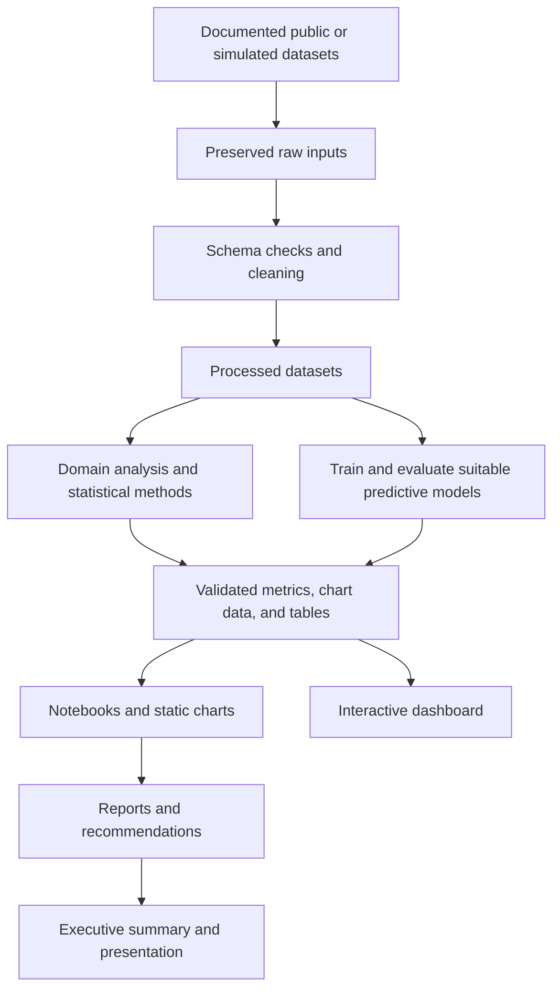

# Project Architecture and File Structure

Status: Architecture in implementation; Phase 1 foundation is underway.
Last updated: 2026-11-04

## 1. Architecture approach

Use a local Python analytics workflow with five domain notebooks, reusable preparation and plotting helpers, saved analysis outputs, and a unified dashboard. The dashboard reads validated derived outputs; it should not retrain models during user interactions. No backend service or database is currently required.

Current stack: pandas and NumPy for processing, Matplotlib/Seaborn for static figures, SciPy for statistical methods, scikit-learn for suitable predictive work, and Streamlit/Plotly for the dashboard. Versions are pinned in `requirements.txt` and verified in project environments during implementation; recreate the environment by following `docs/setup.md`. Choose PDF and slide generation tooling during reporting preparation.

## 2. Proposed directory tree

```text
Complete Data Analysis Portfolio/
|-- PRD.md
|-- architecture.md
|-- Rules.md
|-- Phases.md
|-- Design.md
|-- Memory.md
|-- README.md
|-- requirements.txt
|-- .gitignore
|-- portfolio_summary.ipynb
|-- executive_summary.pdf
|-- project1_sales_analysis/
|   |-- README.md
|   `-- analysis.ipynb
|-- project2_healthcare_analysis/
|   |-- README.md
|   `-- analysis.ipynb
|-- project3_sports_analytics/
|   |-- README.md
|   `-- analysis.ipynb
|-- project4_financial_analysis/
|   |-- README.md
|   `-- analysis.ipynb
|-- project5_ecommerce_analytics/
|   |-- README.md
|   `-- analysis.ipynb
|-- datasets/
|   |-- README.md
|   |-- catalog.csv
|   |-- raw/<domain>/
|   `-- processed/<domain>/
|-- src/
|   |-- __init__.py
|   |-- paths.py
|   |-- contracts.py
|   |-- data_io.py
|   |-- cleaning.py
|   |-- statistics.py
|   |-- visualization.py
|   `-- domains/
|       |-- __init__.py
|       |-- sales.py
|       |-- healthcare.py
|       |-- sports.py
|       |-- finance.py
|       `-- ecommerce.py
|-- dashboard/
|   |-- app.py
|   |-- components.py
|   `-- pages/
|       |-- 1_Sales.py
|       |-- 2_Healthcare.py
|       |-- 3_Sports.py
|       |-- 4_Finance.py
|       `-- 5_Ecommerce.py
|-- outputs/<domain>/
|   |-- metrics.json
|   |-- chart_data/
|   `-- tables/
|-- models/<domain>/
|-- reports/
|   |-- source/<domain>.md
|   |-- project1_sales_report.pdf
|   |-- project2_healthcare_report.pdf
|   |-- project3_sports_report.pdf
|   |-- project4_financial_report.pdf
|   `-- project5_ecommerce_report.pdf
|-- visualizations/
|   |-- inventory.csv
|   `-- <domain>/
|-- recommendations/<domain>.md
|-- presentation/
|   |-- outline.md
|   |-- portfolio_presentation.pptx
|   `-- assets/
|-- docs/
|   |-- setup.md
|   |-- notebook-template.md
|   |-- methodology.md
|   |-- data_dictionary.md
|   |-- validation.md
|   |-- fixtures/root_resolution.ipynb
|   |-- acceptance_matrix.md
|   `-- screenshots/
|-- scripts/
|   |-- download_sources.py
|   |-- prepare_data.py
|   |-- build_outputs.py
|   |-- verify_notebook_contract.py
|   `-- validate_artifacts.py
`-- tests/
    |-- test_cleaning.py
    |-- test_metrics.py
    `-- test_output_contracts.py
```

`<domain>` means `sales`, `healthcare`, `sports`, `finance`, or `ecommerce`. Angle-bracket paths are placeholders, not literal directory names. This is the target structure, not a claim that every listed artifact exists. Create files only when needed in an authorized phase. Model artifacts exist only for justified predictive work. The `tests/` paths describe planned focused coverage; no project test suite has been added or run.

## 3. Responsibilities

| Path | Purpose |
| --- | --- |
| Six root planning documents | Requirements, architecture, boundaries, execution sequence, experience design, and continuity |
| `README.md` | Portfolio overview, setup entry point, project navigation, deliverable links, and limitations |
| `requirements.txt` | Python dependency versions actually verified for the project |
| `.gitignore` | Exclude local environments, credentials, caches, and unsuitable large/private artifacts |
| Domain project folders | Domain question, notebook narrative, analysis, and links to centralized results |
| `datasets/raw/` | Original input snapshots; preserve unchanged and redistribute only when permitted |
| `datasets/processed/` | Reproducible cleaned datasets, regenerated from documented inputs |
| `datasets/catalog.csv` | Dataset ID, domain, origin, retrieval date, version, usage terms, path, and checksum when available |
| `src/paths.py` | Project-root discovery and safe canonical artifact paths |
| `src/contracts.py` | Versioned metric metadata and domain chart manifest contracts, including schema validation |
| `src/data_io.py` | Project-relative raw loading and processed CSV output |
| `src/cleaning.py` | Reusable quality profiling and explicit unknown-token normalization |
| `src/statistics.py` | Reusable descriptive statistics and uncertainty helpers; method assumptions remain domain-specific |
| `src/visualization.py` | Consistent static chart artifact saving |
| `src/domains/` | Domain transformations and metric calculations shared by notebooks and output generation |
| `dashboard/app.py` | Portfolio landing page and navigation entry point |
| `dashboard/components.py` | Shared KPI cards, source labels, filter summaries, and empty-state rendering |
| `dashboard/pages/` | Domain views that filter validated detail or aggregate outputs |
| `outputs/` | Derived metric snapshots, dashboard chart data, and report tables |
| `models/` | Optional model artifacts and metadata; never load untrusted serialized models |
| `reports/source/` | Editable report narratives used to create the PDF deliverables |
| `reports/` | Final five domain PDF reports |
| `visualizations/` | Static figures organized by domain and an inventory of unique chart purposes |
| `recommendations/` | Evidence-linked actions, expected direction of benefit, caveats, and monitoring metrics |
| `portfolio_summary.ipynb` | Cross-project navigation, methodological summary, and verified portfolio totals |
| `executive_summary.pdf` | Portfolio-wide nontechnical summary; avoid duplicating this canonical file elsewhere |
| `presentation/` | Slide outline, final deck, and supporting assets |
| `docs/` | Setup, methodology, dictionaries, checks, screenshots, and acceptance evidence |
| `scripts/` | Documented preparation, output generation, and artifact checks, including metrics and chart manifest schema checks when files exist |
| `tests/` | Focused tests for consequential transformations, metric logic, and output contracts |

## 4. Data flow



This diagram describes the intended architecture, not existing implemented components.

## 5. Shared output contract

- `metrics.json`: schema version, domain, dataset version, generation timestamp, data coverage, metric names, values, units, denominators where relevant, and limitations.
- Chart data: documented CSV or Parquet tables with stable column names, date types, units, aggregation level, and filter dimensions.
- Filterable dashboard metrics must be computed from compatible detail or grouped data. A fixed snapshot must not appear to respond to filters it does not support.
- Model results: baseline, split strategy, features, evaluation window, metric definitions, scores, and limitations. Link to artifacts only if created.
- `visualizations/inventory.csv`: chart ID, domain, title, question answered, chart type, input source, output path, and report reference.
- Phase 1 uses CSV for processed tables because it is transparent to inspect and works with the current pandas I/O contract. Revisit if measured output size or dashboard performance shows CSV is inadequate.

## 6. Execution and artifact ownership

Run documented commands from the project root. Notebooks and scripts import the same metric logic to avoid inconsistent calculations. Generated files are reproducible outputs; changes should originate from their source data or generation logic.

Do not duplicate raw data or reports in project folders. Link from each domain README to the canonical shared locations. If a dataset cannot be redistributed, supply retrieval instructions and document the resulting reproduction dependency.

## 7. Validation approach

Check source schemas, important transformations, denominators, totals, split integrity, baseline comparisons, notebook execution, artifact existence, chart counts, dashboard/report agreement, and local links. Record actual commands and outcomes. Final module boundaries may be simplified if real datasets do not justify a proposed abstraction; update this document when decisions change.

## 8. Planning artifacts and execution contracts

- [Construction Blueprint](plans/portfolio-blueprint.md): ten reviewable steps, dependencies, ownership, proposed verification commands, and recovery protocol.
- [Blueprint review](plans/blueprint-review.md): independent adversarial findings and author resolutions.
- [Diagram guide](docs/diagrams.md): architecture, workflow, data flow, offline sequence, and dashboard interaction sequence with source mapping.
- Diagram artifacts are summarized in [the diagram guide](docs/diagrams.md); generated design receipts and local checkpoints are excluded from the final handoff.
- Proposed `visualizations/<domain>/manifest.csv`: domain-owned chart entries merged into shared inventory by the integrator in S7.
- Proposed `tests/<domain>/`: isolated domain test ownership; shared tests remain integrator-owned.
- Before real domain work, verify nested-notebook project-root imports and an explicit environment/kernel strategy. Domain, integration, submission, and final acceptance validation have separate readiness levels, defined in the Blueprint.


