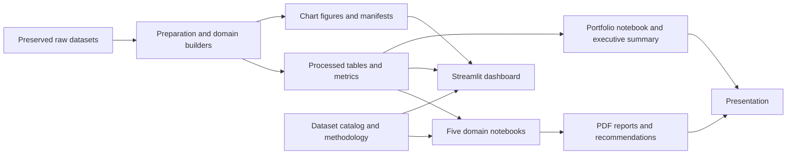
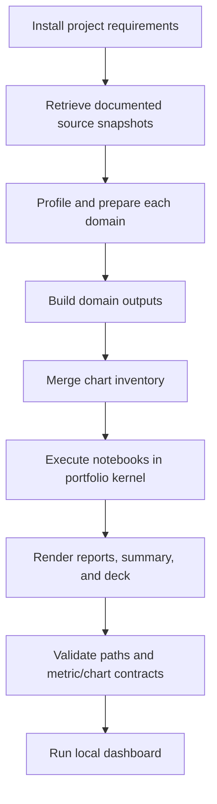
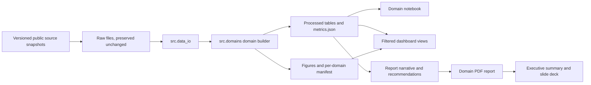
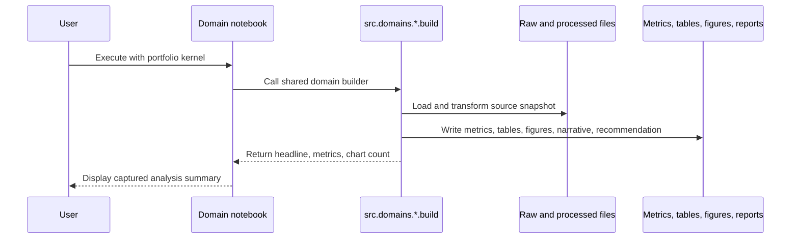
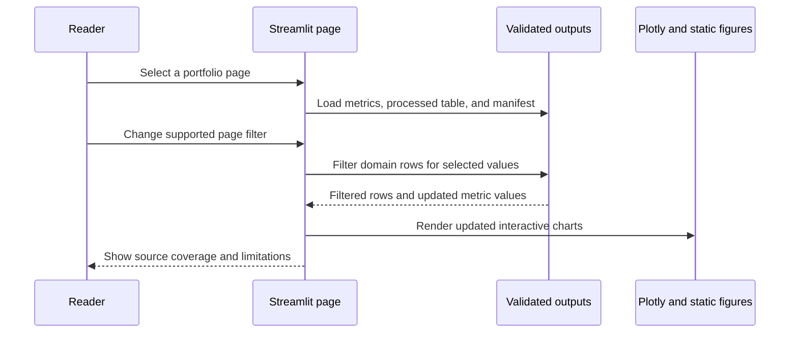

# Project diagrams

These diagrams describe the implemented local workflow as of 2026-11-07. They are source-mapped to the current repository; they do not imply cloud hosting, publication, or production services.

## Architecture

**Source mapping:** `datasets/raw/` and `datasets/catalog.csv`; `scripts/prepare_data.py`, `src/domains/`, and `scripts/build_outputs.py`; `outputs/`; `visualizations/`; `project*/analysis.ipynb`; `dashboard/app.py`; `reports/`; `recommendations/`; `portfolio_summary.ipynb`; `scripts/render_executive_summary.py`; `scripts/render_presentation.py`.

## Reproduction workflow

**Source mapping:** `docs/setup.md`; `scripts/download_sources.py`; `scripts/prepare_data.py`; `scripts/build_outputs.py`; `scripts/merge_chart_inventory.py`; `scripts/execute_notebooks.py`; `scripts/render_reports.py`; `scripts/render_executive_summary.py`; `scripts/render_presentation.py`; `scripts/validate_artifacts.py`; `dashboard/app.py`.

## Data flow

**Source mapping:** loaders are in `src/data_io.py`; domain transformations are in `src/domains/{sales,healthcare,sports,finance,ecommerce}.py`; output helpers are in `src/domains/common.py`; contracts are in `src/contracts.py`; dashboard consumers are in `dashboard/app.py`; report rendering is in `scripts/render_reports.py`.

## Domain analysis execution

**Source mapping:** the domain notebooks call the builders in `src/domains/`; root resolution is defined in each notebook cell; `scripts/execute_notebooks.py` executes the five notebooks and `portfolio_summary.ipynb`.

## Dashboard interaction

**Source mapping:** page navigation, filters, loading, empty states, downloads, and charts are implemented in `dashboard/app.py`. The dashboard reads local files under `outputs/`, `datasets/processed/`, and `visualizations/`; it does not query a remote service.
