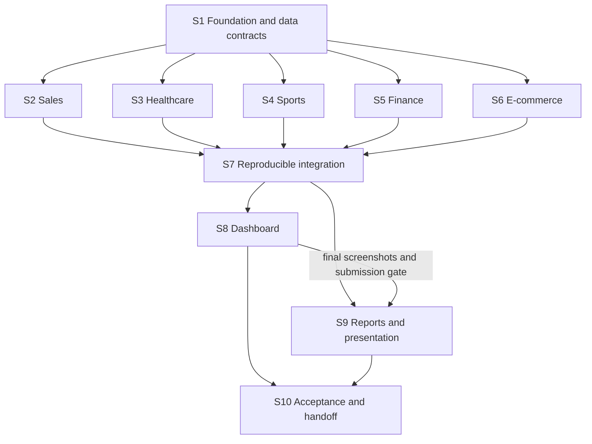

# Complete Data Analysis Portfolio — Construction Blueprint

Version: 1.2, 2026-11-04. Status: Reviewed construction plan; Phase 1 implementation underway after user authorization on 2026-11-04.
Scope: staged local implementation under the user's instruction to follow the design and workflow. Commit, push, publication, deployment, and paid-service work remain unauthorized.

## Objective and source of truth

Deliver five reproducible domain projects, five notebooks, five PDF reports, 25+ useful visualizations, recommendations, master notebook, executive summary, slides, documentation, and the planned unified local dashboard. Read `PRD.md`, `Rules.md`, `architecture.md`, `Design.md`, `Phases.md`, and `Memory.md` before each phase. Requirements and proposed components must be distinguished from completed outputs.

All paths below are relative to the project root unless explicitly described otherwise. Each numbered step is one independently reviewable change set. The user has authorized local implementation and data acquisition phase-by-phase; no commits, branches, PRs, pushes, deployment, or paid services are authorized.

## Preflight evidence

- Git is available. Actual repository root is the parent `G:/Developers_Arena/Developers_Arena_Internship`.
- Origin is `https://github.com/Yashovardhan-Tripathi/Developers_Arena_Internship.git`; local origin HEAD points to `origin/main`. Remote freshness was not checked.
- The project appears as untracked content in the parent repository. Do not interpret that as an empty parent repository.
- `gh` is unavailable in the current shell. GitHub authentication and remote branch protections cannot be verified through it.
- Execution mode: direct local edits; no branch/PR workflow is assumed. If later requested, inspect remotes, ownership, current changes, and remote state before publication.

## Global invariants

1. Work stays inside this project; preserve other internship content and user edits.
2. Raw data stays unchanged; source, retrieval date, usage terms, schema, units, and coverage are traceable.
3. No invented results, copied sample figures, unsupported causal claims, or unspecified denominators.
4. Every predictive pipeline addresses temporal/entity leakage and compares to a suitable baseline.
5. Notebooks, reports, and dashboard share metric definitions and data versions.
6. Missing data is not zero; simulated data is visibly labeled; sensitive data and secrets are excluded.
7. Step completion requires real evidence. Verification commands below are phase contracts; actual commands and outcomes are recorded in `docs/validation.md`.

## Dependency graph



S2–S6 are parallel candidates after S1 only if they own disjoint domain paths. S9 drafting can overlap S8 after S7; S9 completion requires S8. Shared dependency files, helpers, chart inventory, acceptance matrix, and Memory.md have a single integrator. Domain contributors return proposed shared edits as notes instead of concurrently modifying those files. This graph describes possible work scheduling; it does not authorize future subagents.

## Verification command conventions

Use PowerShell from the project root with the project environment active. These CLI contracts are implemented; recorded Phase 1 outcomes are in `docs/validation.md`. Run relevant commands for the current phase and record actual results:

```powershell
python scripts/prepare_data.py --domain sales --check-only
python scripts/build_outputs.py --domain sales
python scripts/build_outputs.py --all
python scripts/validate_artifacts.py --domain sales
python scripts/validate_artifacts.py --all --submission
python -m pytest tests/test_cleaning.py tests/test_metrics.py tests/test_output_contracts.py
python -m jupyter nbconvert --to notebook --execute --inplace project1_sales_analysis/analysis.ipynb
python -m streamlit run dashboard/app.py
```

`--check-only` validates existing local inputs without downloading, modifying raw files, or building outputs. `--domain` accepts sales, healthcare, sports, finance, or ecommerce. `--all` runs all domains. `--submission` checks required final artifact paths. Partial domain validation must not require unfinished domains. The artifact validator checks required paths and validates metrics/chart schemas when those files exist; local-link and chart-count validation remain final acceptance work. Notebook execution must be deterministic and must not append duplicate chart inventory entries.

Validation levels are explicitly separate:

- Domain validation checks that domain's notebook, output contracts, `visualizations/<domain>/manifest.csv`, editable report narrative, and recommendation document. It does not require merged inventory, final PDFs, other domains, or dashboard files.
- Integrated `--all` validation checks all domain outputs plus merged `visualizations/inventory.csv`; final reports and UI are not yet mandatory.
- `--all --submission` checks deliverable files, dashboard screenshots, local links, and chart counts. It does not require a completed acceptance matrix or S10 handoff record; those are audited independently in S10 to avoid circular dependencies.
- S1 implements callable CLI interfaces with fixture coverage and clear not-yet-implemented domain errors. Actual domain builders become available in S2–S6; S1 does not need to produce their analyses.

Notebook execution contract: S1 must document the selected environment/kernel and a tested project-root resolution strategy. Each nested notebook resolves the root by finding this project's `PRD.md` plus `src/`, makes shared imports available, and resolves data/output paths from that root rather than the kernel's starting directory. Register a dedicated kernel in an authorized local environment or pass an explicitly verified kernel name to nbconvert; update commands in `docs/setup.md`. Verify the contract with a minimal nested fixture notebook before domain work. Notebook metadata alone is not evidence that the kernel matches the active environment.

Recovery contract: before each authorized implementation step, capture existing owned files and a manifest of new paths in a project-local ignored checkpoint (or record a later user-authorized commit as the recovery base). Record its path and date in project memory. The S1 shared-contract work has a recovery snapshot at `.checkpoints/S1-before-shared-contracts-2026-11-04/`; it excludes raw data. Restore only explicitly reviewed owned paths, compare against intervening user edits, preserve raw data, and never automatically delete newly created files. The rollback instructions below refer to this recorded recovery base.

Domain contributors own `visualizations/<domain>/manifest.csv` and may add tests under `tests/<domain>/`. Shared tests remain integrator-owned. Each manifest uses the same chart inventory fields defined in architecture.md; S7 merges manifests after checking IDs, paths, purposes, and duplicates.

## S1 — Foundation, datasets, and interface contracts

Dependencies: user instruction to implement. Phase mapping: Phase 1. Model tier for future execution: strongest available for contracts and dataset suitability.

Context brief: This portfolio needs five distinct domains and reproducible local outputs. The parent repository contains unrelated internship work; do not change it. Dashboard tools and datasets were provisional at planning time and are now selected for local implementation.

Implementation status (2026-11-04): all five domain inputs are downloaded/profiled, and the local environment, setup files, reusable helpers, metric/chart contracts, and phase-aware CLIs exist. The project-local `.venv` installed pinned requirements and representative data loading passed. Nested root resolution works in ordinary Python; fresh-kernel execution remains blocked by Windows `WinError 623` during Jupyter startup. Shared contract validation was strengthened in source, but no fixture/runtime check has been run for this latest change. `docs/validation.md` records commands and outcomes. S1 remains open pending fresh-kernel verification and contract validation. The project path sits inside a parent repository; current Git status could not be read because the configured worktree path is unavailable in this shell.

Owned paths: project-local `requirements.txt`, `.gitignore`, `datasets/README.md`, `datasets/catalog.csv`, `docs/setup.md`, `docs/data_dictionary.md`, initial `src/`, `scripts/`, `tests/`, and output schemas. Do not create dummy reports or pretend scripts have passed.

Tasks:

1. Recheck rules and state; confirm final stack within authorized scope and record dashboard treatment.
2. Assess five dataset candidates against source, usage terms, schema, time coverage, statistical usefulness, privacy, and practical size. Reject unsuitable sources and record alternatives.
3. Freeze dataset IDs and raw snapshots; write retrieval instructions for sources that cannot be redistributed.
4. Define shared metrics/metadata/chart-table contracts, domain dictionary conventions, and error behavior.
5. Build minimal common I/O, cleaning, statistical, and chart helpers plus CLI contracts above. Use fixtures to validate them before real outputs exist.
6. Document actual environment setup and checked versions in the isolated project environment.

Verification: inspect provenance and dictionaries for all five sources; run `python -m pytest tests/test_cleaning.py tests/test_output_contracts.py`; run `python scripts/prepare_data.py --domain <domain> --check-only` once per selected domain, substituting an actual domain name.

Exit: five usable input sources, stable contracts, reproducible loading, valid raw/processed separation, fixture-tested callable interfaces, tested nested-notebook/root/kernel setup, and recorded test outcomes. Update the exact CLI syntax here if implementation chooses a different interface.

Rollback: revert only this step's reviewed project-local changes after checking user modifications. Preserve original raw snapshots and retrieval metadata; never use a parent-wide reset or delete.

## S2 — Business sales analysis

Dependencies: S1. Phase mapping: Phase 2. Model tier: default; strongest review for ambiguous retention/profit definitions.

Context brief: Implement a commercial performance analysis using S1's documented sales source and contracts. Questions concern time trends, product contribution, orders, and customers. Require five meaningful charts and suitable statistics. Revenue is not profit; retention requires defined cohorts and observation windows. Prediction is conditional on suitable data.

Owned paths: `project1_sales_analysis/`, `src/domains/sales.py`, `datasets/processed/sales/`, `outputs/sales/`, `visualizations/sales/`, `reports/source/sales.md`, `recommendations/sales.md`, and optional `models/sales/`. Return inventory entries and shared-helper requests to the integrator.

Tasks: document grain and currency; reconcile orders/line items; profile and clean; define KPIs; analyze trends and product/customer patterns; run justified statistical comparisons; assess forecasting or churn suitability; compare any model to a baseline; save outputs and report narrative with limitations.

Verification: run `python scripts/build_outputs.py --domain sales`, execute the sales notebook with the documented nbconvert command, and run `python scripts/validate_artifacts.py --domain sales`. Independently reconcile revenue and order counts on a small known fixture.

Exit: notebook executes; five chart entries are proposed; output totals and denominators reconcile; recommendations cite actual findings; report source and predictive suitability record exist.

Rollback: preserve inputs; restore only reviewed sales changes; regenerate sales outputs from the prior source version. Do not remove shared contracts.

## S3 — Healthcare analysis

Dependencies: S1. Phase mapping: Phase 3. Model tier: strongest available for outcome definitions and confounding review.

Context brief: Use the selected de-identified or labeled synthetic healthcare source. The portfolio demonstrates analysis, not clinical decision support. Encounter counts, patient counts, outcomes, stays, costs, and readmissions require distinct definitions and supported fields.

Owned paths: `project2_healthcare_analysis/`, `src/domains/healthcare.py`, `datasets/processed/healthcare/`, `outputs/healthcare/`, `visualizations/healthcare/`, `reports/source/healthcare.md`, `recommendations/healthcare.md`, optional `models/healthcare/`.

Tasks: audit identifiers/privacy and grain; define outcomes and eligible population; profile/clean; analyze distributions and groups with sample sizes, uncertainty, and confounding caveats; produce five useful charts; assess prediction suitability and entity-aware splitting; save findings and operational recommendations.

Verification: run `python scripts/build_outputs.py --domain healthcare`; execute `project2_healthcare_analysis/analysis.ipynb` using nbconvert as in command conventions; run `python scripts/validate_artifacts.py --domain healthcare`. Independently check one outcome rate against eligible records and inspect exported artifacts for identifiers.

Exit: complete executable analysis, five chart entries, source narrative, recommendations, explicit limitations, and no identifiable patient data in exports. Unsupported outcomes are omitted with reasons.

Rollback: restore only reviewed healthcare artifacts; retain provenance and raw inputs; rebuild from the prior healthcare version without changing shared contracts.

## S4 — Sports analytics

Dependencies: S1. Phase mapping: Phase 4. Model tier: default; strongest review for match prediction leakage.

Context brief: Use S1's sports dataset to compare players and teams fairly and explain match/season patterns. Normalize by participation where relevant. Match prediction may consume only features available before the match.

Owned paths: `project3_sports_analytics/`, `src/domains/sports.py`, `datasets/processed/sports/`, `outputs/sports/`, `visualizations/sports/`, `reports/source/sports.md`, `recommendations/sports.md`, optional `models/sports/`.

Tasks: define competitions, seasons, grain, and exposure; clean and analyze; produce five charts and suitable statistical comparisons; assess prediction; use temporal/group-aware evaluation and a baseline where implemented; write recommendations and limitations.

Verification: run `python scripts/build_outputs.py --domain sports`; execute `project3_sports_analytics/analysis.ipynb` via nbconvert; run `python scripts/validate_artifacts.py --domain sports`. Check a known team/player aggregate and audit feature availability at prediction time.

Exit: reproducible results, five chart entries, defensible comparisons, source narrative, and justified predictive suitability/evaluation record.

Rollback: restore only reviewed sports changes and regenerate affected outputs from the prior version; retain raw inputs and shared contracts.

## S5 — Financial analysis

Dependencies: S1. Phase mapping: Phase 5. Model tier: strongest available for time-series and risk assumptions.

Context brief: Use S1's financial dataset for historical returns and risk analysis. State adjusted price policy, trading calendar, frequency, portfolio weights, rebalancing, transaction-cost assumptions if used, and annualization factors. These analyses do not establish investment performance guarantees.

Owned paths: `project4_financial_analysis/`, `src/domains/finance.py`, `datasets/processed/finance/`, `outputs/finance/`, `visualizations/finance/`, `reports/source/finance.md`, `recommendations/finance.md`, optional `models/finance/`.

Tasks: validate price/time ordering; compute defined returns, volatility, drawdown, and correlations; produce five charts and statistical interpretation; assess prediction with chronological evaluation; document survivorship and historical-coverage limits; save source narrative and recommendations.

Verification: run `python scripts/build_outputs.py --domain finance`; execute `project4_financial_analysis/analysis.ipynb` via nbconvert; run `python scripts/validate_artifacts.py --domain finance`. Compare return and maximum-drawdown calculations with a small manually computed series.

Exit: executable analysis, reconciled risk calculations, five chart entries, explicit portfolio assumptions, and evaluated or justifiably omitted prediction.

Rollback: restore only reviewed finance changes and rebuild derived artifacts from the prior version; preserve source provenance and raw data.

## S6 — E-commerce analysis

Dependencies: S1. Phase mapping: Phase 6. Model tier: default; strongest review for segmentation evaluation.

Context brief: Focus on customer groups and purchase behavior rather than duplicating S2's commercial trend analysis. Returns, cancellations, customer eligibility, and order grain materially change repeat-purchase rates and basket analysis.

Owned paths: `project5_ecommerce_analytics/`, `src/domains/ecommerce.py`, `datasets/processed/ecommerce/`, `outputs/ecommerce/`, `visualizations/ecommerce/`, `reports/source/ecommerce.md`, `recommendations/ecommerce.md`, optional `models/ecommerce/`.

Tasks: define return/cancellation handling; clean and analyze customer/purchase patterns; produce five charts and suitable statistics; assess RFM, clustering, basket, or recommendation suitability; validate selected segmentation/recommendation methods; document limitations and save narrative/recommendations.

Verification: run `python scripts/build_outputs.py --domain ecommerce`; execute `project5_ecommerce_analytics/analysis.ipynb` via nbconvert; run `python scripts/validate_artifacts.py --domain ecommerce`. Check repeat-customer denominators and segment totals against known input records.

Exit: distinct domain narrative, five chart entries, reproducible outputs, meaningful segment evaluation if used, and evidence-linked recommendations.

Rollback: restore only reviewed e-commerce changes, preserve input snapshots, and regenerate affected outputs without changing shared contracts.

## S7 — Reproducible integration

Dependencies: S2, S3, S4, S5, S6. Phase mapping: domain closeout and integration before Phase 7. Model tier: strongest available for cross-project contract review.

Context brief: Five domain analyses now have output candidates. A single integrator owns shared helpers, dependency updates, output metadata, chart inventory, and progress records. Consumers must receive stable filterable tables and consistent units/denominators.

Owned paths: shared `src/`, `scripts/`, `tests/`, `requirements.txt`, `visualizations/inventory.csv`, `docs/methodology.md`, `docs/data_dictionary.md`, `docs/acceptance_matrix.md`, and shared metadata corrections. Domain edits require coordination.

Tasks: merge proposed shared changes; validate all contracts; reconcile metric definitions; deduplicate chart IDs; verify 25+ meaningful charts; implement deterministic `--all`; record quality/statistical/model evidence and asset versions; check repeated execution does not accumulate duplicates.

Verification: run `python scripts/build_outputs.py --all`; run the three test modules in command conventions; run `python scripts/validate_artifacts.py --all` without `--submission`; execute all five notebooks from fresh kernels and compare key outputs before and after a repeat run.

Exit: stable versioned outputs ready for dashboard/report consumption, all domain checks pass, source-to-output lineage is traceable, and all outstanding domain defects are resolved or reported.

Rollback: restore the prior reviewed shared contract and its consumers together; invalidate and rebuild derived outputs. Preserve datasets and domain source narratives.

## S8 — Interactive dashboard

Dependencies: S7 and resolved dashboard scope. Phase mapping: Phase 7. Model tier: default.

Context brief: Build the proposed local Streamlit/Plotly UI from `Design.md` with overview and five domain pages. Read versioned chart tables and metric definitions from S7. Filtering must not retrain models or silently mix dataset versions.

Owned paths: `dashboard/`, dashboard-specific tests or fixtures, and `docs/screenshots/dashboard/`. Shared dependency changes go through the integrator.

Tasks: create navigation, source/coverage labels, supported filters/reset, KPI/chart views, accessible summaries, permitted downloads, and loading/empty/missing/schema/error states. Compute filtered values from compatible data; label fixed reference metrics explicitly.

Verification: run `python -m streamlit run dashboard/app.py`; manually check all six views at 1440, 1024, and 390 px; exercise keyboard focus, filters/reset, no-match, missing-input, and invalid-schema cases using isolated fixtures; compare filtered KPI values to direct computations. Record evidence in `docs/validation.md` through the integrator.

Exit: dashboard is locally usable and consistent with outputs, interaction states are demonstrated, actual screenshots exist, and framework/accessibility limitations are recorded.

Rollback: restore dashboard-only changes and return to documented notebook/report navigation. Preserve validated analysis outputs; retain a record if required dashboard scope cannot be satisfied.

## S9 — Reports and portfolio presentation

Dependencies: S7 for drafting; S8 for finalization, final UI screenshots, and submission checks. Phase mapping: Phase 8. Model tier: default.

Context brief: Package real results for evaluators and nontechnical readers. Existing domain report sources and recommendations supply evidence. Do not carry illustrative numbers from the brief into final findings or invent financial/clinical impact.

Owned paths: `reports/`, `recommendations/`, `presentation/`, `portfolio_summary.ipynb`, `executive_summary.pdf`, project READMEs, root `README.md`, and submission documentation coordinated with the integrator.

Tasks: finalize five PDFs and editable sources; create master notebook, executive summary, slides, and recommendation documents; include sources/limits; create navigation and setup links; reconcile numbers/units and add actual screenshots after S8. Record generation tooling and commands in setup documentation.

Verification: execute the master notebook via nbconvert; run `python scripts/validate_artifacts.py --all --submission`; visually inspect every PDF and slide for clipping, legibility, chart labels, page breaks, and references; check representative totals against S7 outputs.

Exit: all submission artifacts exist, open correctly, tell consistent evidence-based stories, and meet documentation requirements. If S8 is unfinished, final screenshot and acceptance completion stays pending.

Rollback: restore report/presentation sources and regenerate their outputs together; never edit generated PDFs as the only source of truth.

## S10 — Final acceptance and handoff

Dependencies: S8 and S9. Phase mapping: Phase 9. Model tier: strongest available for adversarial acceptance review.

Context brief: The portfolio is ready for a reproduction audit, not automatically ready for production or publication. All PRD requirements need actual evidence, including statistics in every domain and prediction suitability decisions.

Owned paths: final `docs/acceptance_matrix.md`, `docs/validation.md`, setup corrections, handoff documentation, and `Memory.md`. Other defects return to their owning step before completion.

Tasks: reproduce setup in a clean project-local environment when authorized; run all builds/notebooks/checks; inspect dashboard and deliverables; verify source terms and tracked-file boundaries; map FR-01–FR-12 to artifacts and check results; identify unresolved gaps honestly; prepare local handoff.

Verification: run all defined build, notebook, test, and submission checks; inspect `git status --short -- .` and `git diff --check -- .` from this project. Untracked content needs separate file/link inspection because Git diff does not validate it. Record commands, dates, environment, limitations, and actual outcomes.

Exit: evidence supports every required item or the project is explicitly marked incomplete with blockers. Local completion is distinct from GitHub publication, deployment, or production validation.

Rollback: withhold completion; reopen the failed owning steps and rebuild their dependents. Preserve evidence of failures and original inputs. No destructive blanket rollback.

## Requirement coverage

| PRD requirements | Owning steps |
| --- | --- |
| FR-01 five projects | S2–S6, verified S10 |
| FR-02 pandas; FR-03 preparation | S1–S7 |
| FR-04 statistical analysis | S2–S6 |
| FR-05 25+ charts | S2–S7 |
| FR-06 recommendations | S2–S6, S9 |
| FR-07 project reports | S2–S6 sources, S9 final PDFs |
| FR-08 interactive metrics | S8, scope resolution S1 |
| FR-09 suitable predictions | S2–S6 suitability/evaluation |
| FR-10 portfolio navigation | S9 |
| FR-11 slides and recommendation documents | S9 |
| FR-12 setup, methodology, screenshots, validation | S1, S7–S10 |

## Plan mutation protocol

Before splitting, inserting, skipping, reordering, or abandoning a step: record date, reason, evidence, affected requirements, dependency changes, output/consumer impacts, and user scope implications. Preserve IDs; use S4a/S4b for a split rather than renumbering completed history. Update graph, verification commands, Phases.md mapping, Memory.md, and affected diagrams. Re-review changed dependencies and critical contracts. A skipped step cannot silently remove a required deliverable; obtain user direction when scope changes are material.

## Review register

Adversarial review completed by an independent strongest-model reviewer; see [blueprint-review.md](blueprint-review.md). No critical findings. Author resolutions in version 1.1:

- R1: added explicit S8 -> S9 finalization edge; only report drafting overlaps dashboard construction.
- R2: separated domain, integration, submission, and final acceptance checks; defined domain manifests and S1 fixture-only interface readiness.
- R3: added nested-notebook root resolution, environment/kernel verification, and fixture execution contract.
- R4: added recoverable direct-mode checkpoints and preservation of intervening user edits.
- R5: synchronized source-document scope and integrator ownership, with domain-owned manifests/tests.

These are planning checks. Script commands, package compatibility, datasets, and runtime results remain unverified until authorized implementation.
