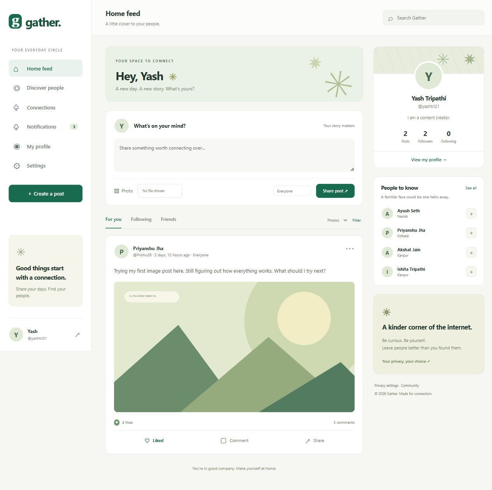

# TimeConnector · Social Media Platform

A complete Django social platform for everyday stories and meaningful connections. Built with a responsive Bootstrap interface, a mobile-ready REST API, and live WebSocket notifications.

**Status:** implemented and verified locally. Cloud deployment is pending at the user's request. Docker and Railway configuration are included; no live production URL or container-runtime verification is claimed.



## Features

- Registration, login/logout, password change, profile avatar/cover, bio, website, and location.
- Text/image posts, edit/delete ownership, likes, comments, and privacy-respecting share links.
- Friend requests, accept/decline/cancel, unfriend, follow/unfollow, and two-way blocking.
- Saved notification inbox, read status, and session-authenticated WebSocket toasts.
- Search for posts/people; filter by friends, following, photos, or API author.
- Public/friends/Only me audiences, private profiles, protected image delivery, reports, and staff moderation.
- Authenticated, paginated REST API with token login and upload support.
- 63 automated tests, migrations, CI workflow, production settings, Docker Compose, and Railway configuration.

The optional chat, groups, and events extension is outside this implementation. Seeded profiles use user-supplied details; posts, comments, and connections are local demonstration content.

## Quick start (Windows PowerShell)

Requires Python 3.13. The validated local environment used Python 3.13.9 and Django 5.2.18.

```powershell
python -m venv .venv
.\.venv\Scripts\python.exe -m pip install -r requirements.lock.txt
Copy-Item .env.example .env
.\.venv\Scripts\python.exe manage.py migrate
.\.venv\Scripts\python.exe manage.py runserver
```

Open http://127.0.0.1:8000 and create an account. SQLite and an in-memory channel layer work locally without extra services. Keep DEBUG=True only for local development. Configure a unique SECRET_KEY in .env; do not commit it.

On macOS/Linux, use `python3 -m venv .venv` and replace the Python command prefix with `.venv/bin/python`.

### Demo login for evaluators

After completing the installation and database migration steps above, populate the local application with demo profiles, posts, comments, likes, and connections:

```powershell
.\.venv\Scripts\python.exe manage.py seed_demo --password 'GatherDemo!2026'
```

Start the server with `.\.venv\Scripts\python.exe manage.py runserver`, then use:

| Login detail | Value |
| --- | --- |
| Login page | [Open the local application](http://127.0.0.1:8000/accounts/login/) |
| Demo member | Yash Tripathi |
| Username | `yashtri21` |
| Password | `GatherDemo!2026` |

The existing demo password is retained after the TimeConnector rename so evaluator access continues to work.

**Suggested evaluation walkthrough:** browse the feed and photo filter, open a post to see comments, try liking or creating a post, and explore **Discover people**, **Connections**, **Notifications**, **My profile**, and **Settings**. This is a regular member account; staff moderation requires a separate administrator account.

For a second browser session, use username `Prishu28` with password `GatherDemo!2026` to explore interactions between members and live notifications. Use a separate browser profile or private window so the sessions remain independent.

The seed command also creates Prishu28, akshat18, smrttwi18, AyushSeth69, and ishu with the supplied password when they do not already exist. It never resets existing users' passwords, refuses production mode, and can be rerun without duplicate seed stories. On a fresh database, the command above creates the documented credentials; if an existing demo account's password was changed, its current password still applies. These credentials are for local evaluation only and must not be used for production accounts.

The six demo profiles use the supplied names, emails, locations and bios; their sample posts/comments were drafted for the demonstration. The existing `yashovardhan` administrator is separate and is never seeded or edited by these commands.

If an older local database still contains the original demo users, run the following **before** seeding. It renames the existing accounts in place, preserves passwords/IDs/relationships, updates known sample content, and saves an ignored SQLite backup under `.local-backups/`:

```powershell
.\.venv\Scripts\python.exe manage.py personalize_demo
```

Already-personalized databases can run it again without duplicate posts/comments. Username conflicts, staff accounts, missing demo users and production mode stop the command. Historical usernames occur only in the conversion command/tests.

### Staff account

```powershell
.\.venv\Scripts\python.exe manage.py createsuperuser
```

Open /admin/ to moderate reports, hide/restore content, and manage users. The demo command does not create a staff user.

## Verification

```powershell
.\.venv\Scripts\python.exe manage.py check
.\.venv\Scripts\python.exe manage.py makemigrations --check --dry-run
.\.venv\Scripts\python.exe manage.py collectstatic --noinput
.\.venv\Scripts\python.exe manage.py test --settings=social_platform.test_settings --verbosity=2
```

The latest recorded local run on 27 October 2026 passed **63 tests**, including real ASGI WebSocket communicators. Test settings use an in-memory SQLite database, image storage, and channel layer. They use fast password hashing only in tests. See the [functionality audit](docs/FUNCTIONAL_AUDIT.md) for the corrected API input bug, additional workflow coverage, browser checks and verification limits.

[Testing evidence](docs/testing.md) explains what was checked and the limits. [Validation log](docs/validation.txt) contains the actual command output. The CI workflow is supplied but has not been run on GitHub.

## Docker

```powershell
docker compose up --build
docker compose exec web python manage.py createsuperuser
```

Compose starts Django ASGI, PostgreSQL, and Redis, with named database/media volumes. It uses development settings and is not a public deployment configuration. Docker is not installed in the current workspace host, so this configuration has not been executed here.

## Project structure

```text
manage.py
requirements.txt              # supported dependency ranges
requirements.lock.txt         # exact versions installed for this validation
social_platform/              # settings, URL routing, ASGI/WSGI
users/                        # profiles, authentication, uploads, seed command
posts/                        # content, interactions, reporting, moderation
friends/                      # requests, follows, blocking
notifications/                # inbox, delivery, WebSocket consumer
api/                          # serializers and REST endpoints
templates/                    # Bootstrap pages and shared partials
static/                       # custom CSS/JS, locally vendored Bootstrap
tests/                        # application and WebSocket tests
docs/                         # guides, evidence, screenshots
scripts/                      # repeatable verification helper
Dockerfile
docker-compose.yml
railway.json
.env.example
.github/workflows/tests.yml
```

Each domain app includes committed schema migrations. db.sqlite3, media uploads, .env, .venv, and collected static files are local runtime artifacts excluded from source control.

## Documentation

- [Complete submission documentation](docs/PROJECT_DOCUMENTATION.md) — overview, setup, architecture, database design, API, user manual, screenshots, and test evidence.
- [Requirement mapping](docs/requirements.md)
- [Architecture, data structures, algorithms, and security](docs/architecture.md)
- [REST API and WebSocket reference](docs/api.md)
- [User and moderator manual](docs/user-manual.md)
- [Tests, screenshots, and validation limits](docs/testing.md)
- [Project analysis questions](docs/analysis.md)

## Privacy at a glance

Everyone means signed-in, non-blocked users. A private profile narrows its posts to accepted friends. Only me remains author-only. Following alone grants no private access. Hidden content disappears for all members. Profile details remain visible to signed-in non-blocked members; email and password hashes are never public API fields.

Images pass authorization on every request, including mobile token requests. No unrestricted media directory is exposed. Shares do not alter audience rules.


## Third-party assets

Bootstrap 5.3.8 CSS is vendored under its MIT license; see [Bootstrap license](static/vendor/BOOTSTRAP-LICENSE.txt). Its missing source-map comment was removed for manifest collection. The demo landscape is drawn procedurally by the seed command; no external stock photos are used.
