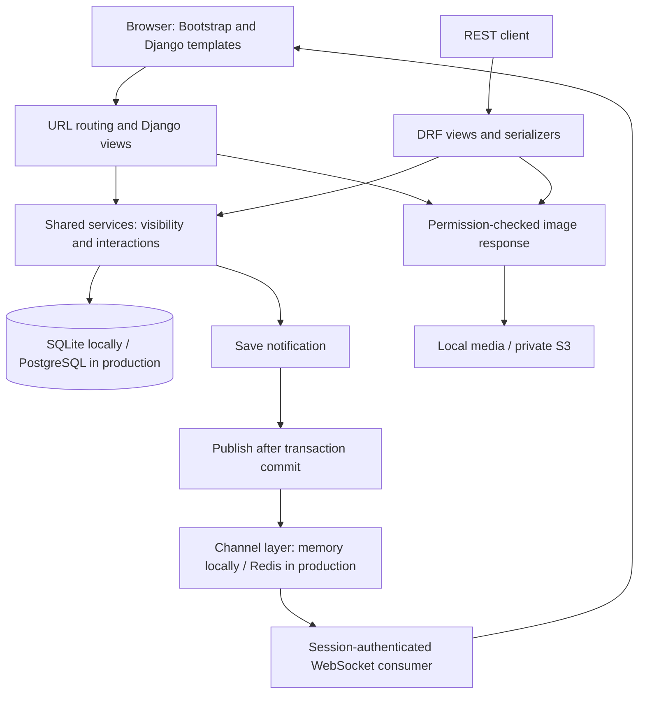
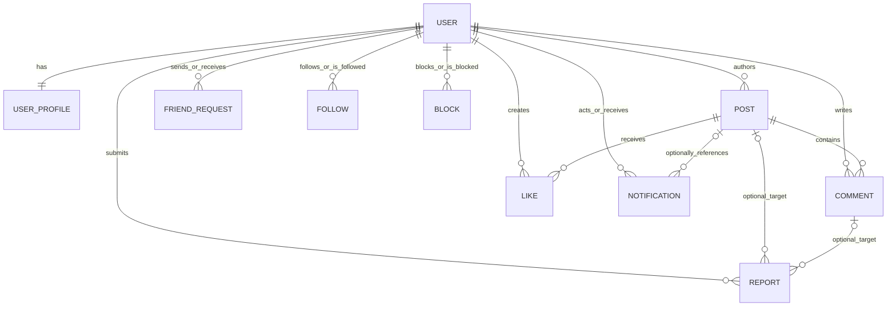
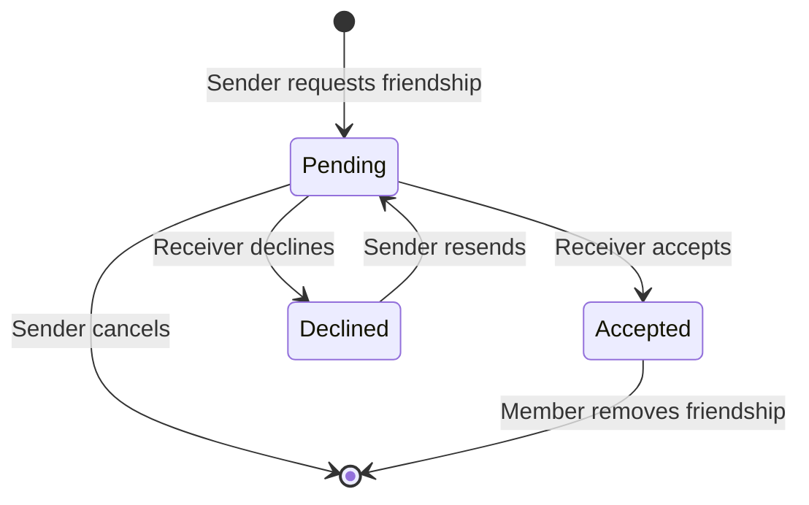
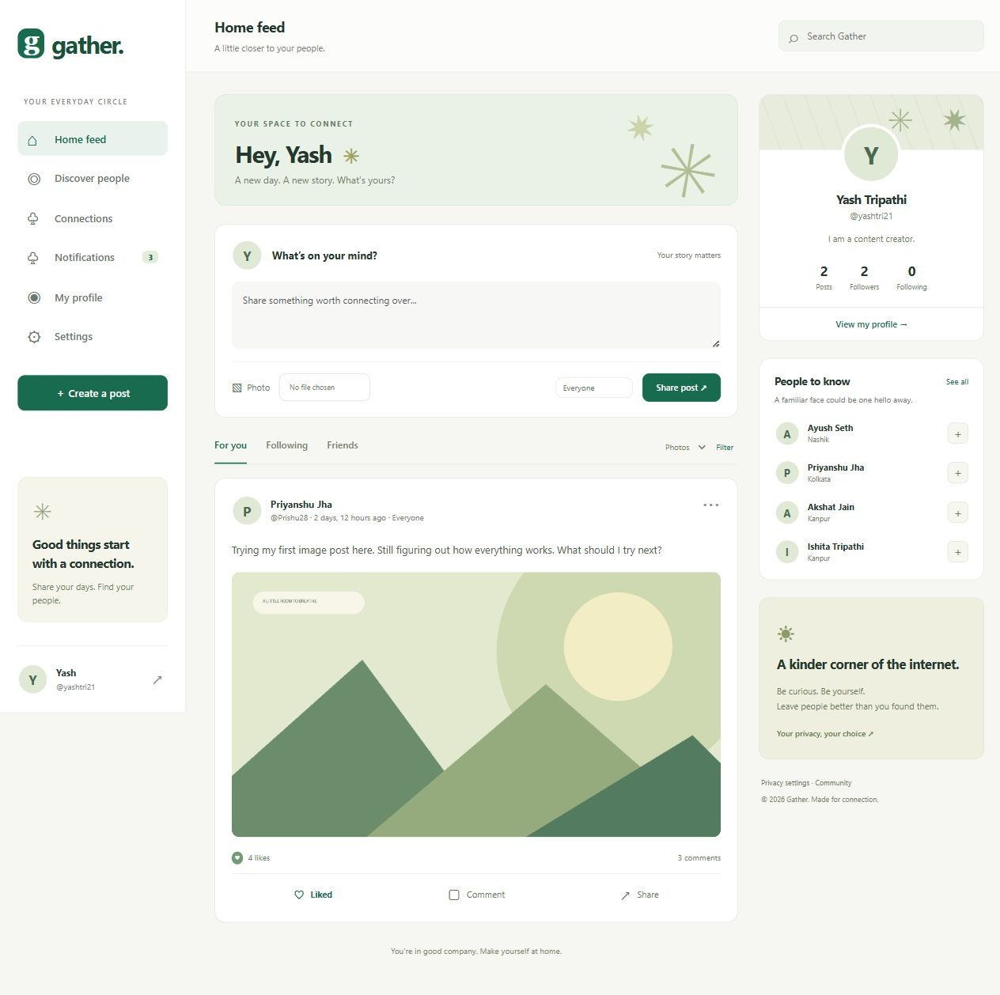
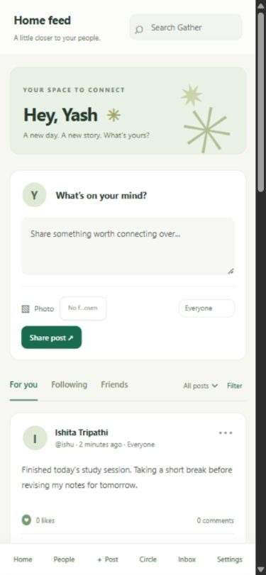
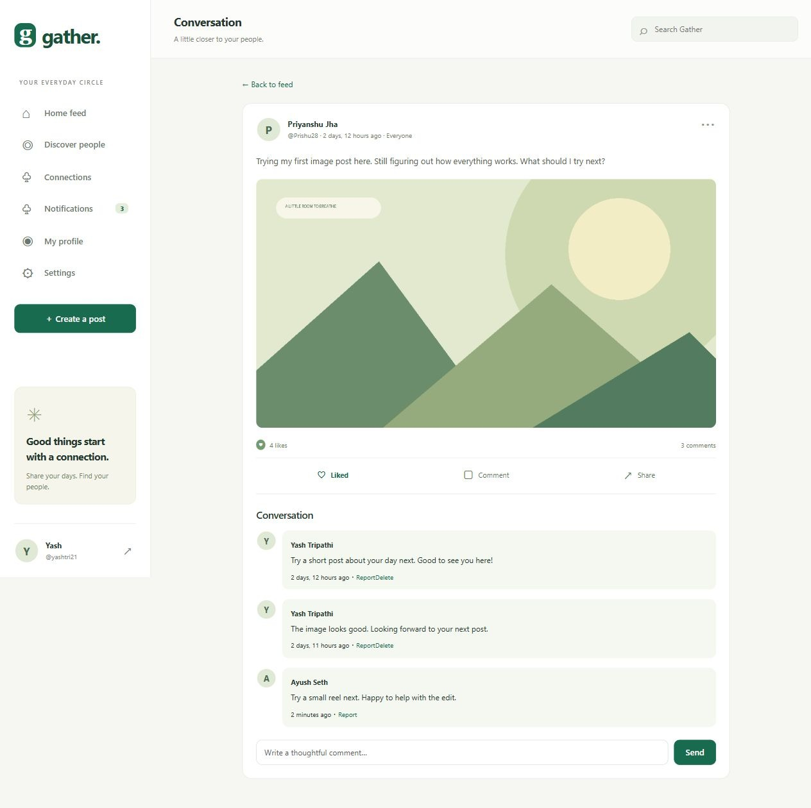
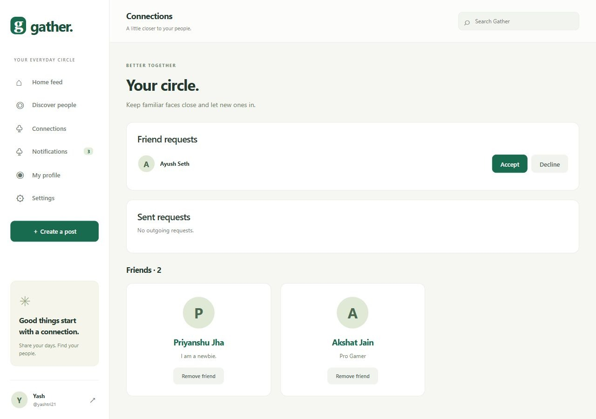
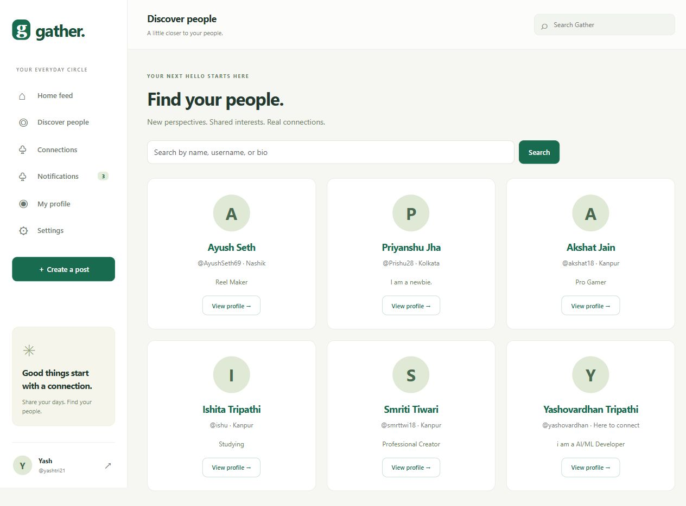

# Gather — Social Media Platform

**Complete Django Project Documentation**  
**Project option:** Option 2 — Standard Version  
**Documentation date:** 24 October 2026  
**Delivery status:** Local application; public deployment pending

## Contents

1. [Project overview](#1-project-overview)
2. [Technology and prerequisites](#2-technology-and-prerequisites)
3. [Installation and configuration](#3-installation-and-configuration)
4. [Code structure](#4-code-structure)
5. [Architecture and database design](#5-architecture-and-database-design)
6. [Algorithms and technical decisions](#6-algorithms-and-technical-decisions)
7. [API documentation](#7-api-documentation)
8. [User and moderator manual](#8-user-and-moderator-manual)
9. [Visual documentation](#9-visual-documentation)
10. [Testing and validation evidence](#10-testing-and-validation-evidence)
11. [Deployment guide](#11-deployment-guide)
12. [Limitations and future enhancements](#12-limitations-and-future-enhancements)
13. [Submission checklist and references](#13-submission-checklist-and-references)

## 1. Project overview

### Purpose

Gather is a Django social media platform where registered members share text and images, comment on posts, like content, manage friendships, and receive notifications. It provides a responsive website and an authenticated REST API for other clients.

The project demonstrates a complete social workflow: create an account, build a profile, connect with people, publish a post with an audience, interact with permitted content, and receive saved and live notifications. Staff can review reports and hide inappropriate content through Django admin.

### Goals and objectives

- Provide account registration, sign-in, profile management, and password changes.
- Support text/image posts, comments, likes, and author-controlled editing/deletion.
- Implement friend requests, acceptance, rejection, cancellation, and removing friends.
- Deliver notifications through a saved inbox and authenticated WebSockets.
- Apply the same privacy and ownership rules to website, API, and image requests.
- Supply reproducible installation, automated checks, screenshots, and deployment instructions.

### Selected project option

| Option | Required features | Project coverage |
| --- | --- | --- |
| 1 — Basic | Posts, comments, likes | Included |
| 2 — Standard | Basic features plus friends, profiles, notifications | **Selected and implemented** |
| 3 — Advanced | Real-time chat, groups, events | Not implemented |

Live notifications do not constitute a chat system. The page titled **Conversation** is a post detail page with comments. Django authentication groups and Channels delivery groups are internal framework mechanisms, not user-created social groups.

Additional implemented features include following, search, audience controls, private profiles, blocking, reporting, staff moderation, protected images, and a paginated REST API. The feed is chronological; no machine-learning recommendation model is included.

### Intended users

| Role | Main capabilities |
| --- | --- |
| Visitor | Register or sign in; view the public infrastructure health response |
| Registered member | Manage own profile, publish and interact with accessible posts, manage connections and notifications |
| Staff moderator | Review reports and hide/restore content with appropriate admin permissions |
| API client | Use authenticated endpoints within the same access rules as the website |

## 2. Technology and prerequisites

| Component | Implementation |
| --- | --- |
| Language | Python 3.13; prior local validation used Python 3.13.9 |
| Web framework | Django 5.2.18 in the dependency lock |
| REST API | Django REST Framework 3.16.1 |
| WebSockets | Django Channels 4.3.2 with Daphne 4.2.3 |
| Frontend | Django templates, Bootstrap 5.3.8, custom CSS and JavaScript |
| Local database | SQLite |
| Production database | PostgreSQL required by production settings |
| Event distribution/cache | In-memory locally; Redis for production |
| Uploaded images | Local filesystem in development; private S3-compatible storage in production |
| Static assets | WhiteNoise compressed manifest storage |
| Image validation | Pillow |
| Tests | Django test framework, DRF API client, Channels WebSocket communicators |

The exact dependency set is in [requirements.lock.txt](../requirements.lock.txt). [requirements.txt](../requirements.txt) contains the supported dependency ranges. A basic local run needs Python and a browser; Docker, Redis, PostgreSQL, and cloud accounts are not required for that workflow.

## 3. Installation and configuration

Run commands from the folder containing `manage.py`.

### Windows PowerShell

1. Open the supplied project folder:

   ```powershell
   Set-Location 'G:\Developers_Arena\Developers_Arena_Internship\Social Media Platform Django'
   ```

   If your copy is elsewhere, use its actual location.

2. Create an isolated environment and install the locked dependencies:

   ```powershell
   python --version
   python -m venv .venv
   .\.venv\Scripts\python.exe -m pip install -r requirements.lock.txt
   ```

3. Create the environment file **only if `.env` does not already exist**:

   ```powershell
   if (-not (Test-Path -LiteralPath .env)) { Copy-Item .env.example .env }
   ```

4. Edit `.env` for local development. Use a generated secret rather than the template value:

   ```powershell
   .\.venv\Scripts\python.exe -c "import secrets; print(secrets.token_urlsafe(64))"
   ```

   Copy that value into `SECRET_KEY`. Do not commit `.env`.

   ```dotenv
   DEBUG=True
   SECRET_KEY=<paste-generated-secret>
   ALLOWED_HOSTS=localhost,127.0.0.1
   CSRF_TRUSTED_ORIGINS=http://localhost:8000,http://127.0.0.1:8000
   DATABASE_URL=
   REDIS_URL=
   USE_S3=False
   ```

   Blank database and Redis values select SQLite and the in-memory channel layer/cache. Existing operating-system environment variables take precedence over `.env`; check them if configuration behaves unexpectedly. Keep `DEBUG=True` confined to local development.

5. Create the database tables and check the project:

   ```powershell
   .\.venv\Scripts\python.exe manage.py migrate
   .\.venv\Scripts\python.exe manage.py check
   ```

6. Optionally create a staff administrator:

   ```powershell
   .\.venv\Scripts\python.exe manage.py createsuperuser
   ```

7. Start the application:

   ```powershell
   .\.venv\Scripts\python.exe manage.py runserver
   ```

8. Open [the local website](http://127.0.0.1:8000), register, and sign in. Open `/admin/` for staff administration or `/api/` for the authenticated browsable API. Stop the server with **Ctrl+C**.

### macOS/Linux equivalent

```bash
cd '/path/to/Social Media Platform Django'
python3 -m venv .venv
.venv/bin/python -m pip install -r requirements.lock.txt
test -f .env || cp .env.example .env
# Edit .env using the local settings above.
.venv/bin/python manage.py migrate
.venv/bin/python manage.py check
.venv/bin/python manage.py runserver
```

The current verification evidence comes from Windows; these commands provide the equivalent interpreter paths for other systems.

### Optional demonstration data

```powershell
.\.venv\Scripts\python.exe manage.py seed_demo --password 'GatherDemo!2026'
```

This creates user-approved demo profiles and drafted sample content in development. Sign in as `yashtri21` using the password passed to the command. Existing user passwords are not reset. The command refuses production mode and does not create a staff account. Demo credentials must not be used for a public release.

The existing administrator `yashovardhan` remains unchanged. Demo identities are:

| Name | Username | Location | Bio |
| --- | --- | --- | --- |
| Yash Tripathi | `yashtri21` | Nashik | I am a content creator. |
| Priyanshu Jha | `Prishu28` | Kolkata | I am a newbie. |
| Akshat Jain | `akshat18` | Kanpur | Pro Gamer |
| Smriti Tiwari | `smrttwi18` | Kanpur | Professional Creator |
| Ayush Seth | `AyushSeth69` | Nashik | Reel Maker |
| Ishita Tripathi | `ishu` | Kanpur | Studying |

For an original local database, run `manage.py personalize_demo` before `seed_demo`. The conversion retains existing user IDs, passwords and connections, updates known demo stories/comments, and saves a private ignored SQLite backup. It refuses username conflicts and staff-account changes. Fresh databases can use `seed_demo` directly. Submitted emails are stored in the approved demo-data module and local account records; these commands do not send email. Historical names remain only in the unmodified original brief and conversion compatibility data.


### Configuration reference

| Variable | Meaning |
| --- | --- |
| `DEBUG` | Local debugging or production mode |
| `SECRET_KEY` | Django signing secret; production requires a strong value of at least 50 characters |
| `ALLOWED_HOSTS` | Comma-separated permitted hostnames, without schemes |
| `CSRF_TRUSTED_ORIGINS` | Comma-separated trusted origins including schemes |
| `DATABASE_URL` | Blank for local SQLite; PostgreSQL URL in production |
| `REDIS_URL` | Shared channel layer and cache; required in production |
| `SECURE_SSL_REDIRECT` | Controls production HTTPS redirects; defaults to true |
| `USE_S3` | Enables the private S3 storage backend; required in production |
| `AWS_STORAGE_BUCKET_NAME` | Private bucket name |
| `AWS_ACCESS_KEY_ID`, `AWS_SECRET_ACCESS_KEY` | Storage credentials; keep secret |
| `AWS_S3_REGION_NAME` | Bucket region |
| `AWS_S3_ENDPOINT_URL` | Optional endpoint for an S3-compatible provider |

### Common setup issues

| Symptom | Resolution |
| --- | --- |
| Python/module not found | Use the `.venv` interpreter and install the lock file with that interpreter |
| Database table missing | Run `manage.py migrate` against the intended local database |
| Disallowed host | Add the exact development hostname to `ALLOWED_HOSTS` |
| CSRF error | Use the configured origin, refresh the form, and retain browser cookies |
| Production configuration error | Supply PostgreSQL, Redis, private S3, a strong secret, and explicit hosts |
| No live toast | Inspect the saved inbox and WebSocket connection; check shared Redis for multiple processes |
| Image upload rejected | Use a valid JPEG/PNG/WebP with matching extension, within size and dimension limits |

## 4. Code structure

```text
Social Media Platform Django/
├── manage.py                    Django management entry point
├── social_platform/
│   ├── settings.py              Environment, database, security and storage
│   ├── urls.py                  Website and API routing
│   ├── asgi.py                  HTTP and authenticated WebSocket routing
│   ├── wsgi.py                  WSGI entry point
│   └── test_settings.py         Isolated test infrastructure
├── users/                       Profiles, registration, settings, image validation
├── posts/                       Posts, likes, comments, reports and visibility
├── friends/                     Requests, following, blocking and relationship rules
├── notifications/               Saved inbox, publication and WebSocket consumer
├── api/                         DRF serializers, views and API URLs
├── templates/                   Server-rendered pages and shared components
├── static/                      CSS, JavaScript and vendored Bootstrap
├── tests/test_platform.py       Platform and WebSocket automated tests
├── scripts/verify.py            Repeatable verification and evidence generation
├── docs/                        Guides, project brief, evidence and screenshots
├── .github/workflows/tests.yml  Supplied continuous-integration workflow
├── requirements.txt             Dependency ranges
├── requirements.lock.txt        Exact dependency versions
├── .env.example                 Configuration template
├── Dockerfile                   Container build and Daphne startup
├── docker-compose.yml           Local PostgreSQL/Redis/application services
├── Procfile                     Release migrations and ASGI process
└── railway.json                 Supplied deployment configuration
```

Domain apps contain models, views/forms or services, and committed migrations as appropriate. Models define persistence; services contain shared business rules; views and serializers adapt those rules to HTTP. Templates and static assets implement presentation.

`db.sqlite3`, `.env`, `.venv/`, `media/`, and `staticfiles/` are local runtime artifacts. They are not substitutes for migrations, configuration templates, or source assets in a submission.

## 5. Architecture and database design

### Application architecture

Gather uses Django's Model–Template–View pattern. A URL selects a view, the view applies authentication and shared services, models query the database, and a template or serializer builds the response. The website uses sessions; external REST clients can use tokens. Daphne serves ASGI so the same application supports HTTP and WebSockets.



**Example request:** a member posts a comment. The server verifies access to the post, validates the comment, saves it with the authenticated author, and creates a notification for the post owner unless it is a self-interaction. Publication occurs after commit. The recipient's socket rechecks visibility before sending the live notification. The saved inbox remains available if live delivery fails.

### Data model

| Entity | Main fields and relationships | Integrity rules |
| --- | --- | --- |
| Django `User` | Username, password hash, names, email, active/staff flags | Django authentication and password validation |
| `UserProfile` | One-to-one user; bio, avatar, cover, location, website, privacy, default audience | Automatically created for a new user |
| `Post` | Author, content, image, visibility, hidden flag, timestamps | Text up to 5,000 characters; text or image required by form/API |
| `Like` | User, post, creation time | Unique `(post, user)` pair |
| `Comment` | Author, post, content, hidden flag, creation time | Nonempty content up to 1,000 characters |
| `FriendRequest` | Sender, receiver, pending/accepted/declined status | Unique directed pair; no self-request |
| `Follow` | Follower, following, creation time | Unique directed pair; no self-follow |
| `Block` | Blocker and blocked user | Unique directed pair; no self-block |
| `Notification` | Recipient, actor, verb, optional post, read state, creation time | Recipient-scoped visibility and delivery |
| `Report` | Reporter, post or comment, reason, status, reviewer/time | Exactly one target; reason up to 1,000 characters |



The relationship diagram summarizes role-based foreign keys. Each report references exactly one of a post or comment, enforced by a database constraint. Friendship is an accepted request in either direction; it does not require a separate friendship table. Follows remain directional. Cascade deletion removes dependent interactions, so moderators should review reports before deleting their targets.

## 6. Algorithms and technical decisions

### Audience and visibility

The shared `visible_posts()` query in [posts/services.py](../posts/services.py) applies these rules:

1. Anonymous callers receive no posts.
2. Hidden posts and inactive authors are excluded.
3. Blocks in either direction exclude the author's posts.
4. Authors can view their own remaining posts.
5. A public post from a non-private profile is visible to signed-in, non-blocked members.
6. Accepted friends can see public and friends posts, including posts from private profiles.
7. Only me posts remain author-only.

Following changes feed selection and does not grant access to private content. Comments and post-linked notifications are filtered against current post visibility. Image endpoints recheck access rather than trusting a previously issued page link.

### Friend-request state transitions



Self-connections, blocked/inactive targets, and requests to an existing friend are rejected. Duplicate pending requests return the existing record. An opposite pending request must be answered by its receiver. Blocking removes requests and follows in both directions and clears notifications between the two users.

The request service uses an atomic transaction and locks both user rows in primary-key order on databases supporting row locks. A response locks its request row. These mechanisms reduce conflicting concurrent changes; PostgreSQL concurrency behavior has not been validated in the local SQLite suite.

### Feed, search, and data structures

The persistent data structure is a relational schema with foreign keys, join tables, indexes, and constraints. Django QuerySets build database queries; lists of connected/blocked user IDs support audience filtering. JSON objects carry API and WebSocket payloads. There is no graph database or custom recommendation engine.

- Posts sort by descending creation time and descending primary key for deterministic ties.
- Website pages contain 10 posts; API lists contain 20 records.
- `select_related()` joins author/profile data; `prefetch_related()` fetches visible comments for a page.
- A database aggregate counts likes; an `Exists` subquery marks whether the caller liked a post.
- Search uses case-insensitive substring matching. Filters select friends, followed users, photos, or an API author ID.
- Uniqueness constraints prevent duplicate relationship/like records. `get_or_create()` makes repeated like requests idempotent and avoids duplicate like notifications.

Actual query cost depends on database size and query plans. No benchmark or constant-time feed claim is made. Prefetching every visible comment for a page can become expensive for long discussions.

### Notification delivery

Notifications are saved before live publication. `transaction.on_commit()` prevents publishing an uncommitted event. Per-user Channels groups route events to the authenticated recipient. Both publication and delivery recheck visibility. Delivery failure is logged while the saved inbox remains available. Browser reconnection uses exponential backoff; offline events do not replay as live toasts.

### Security and validation

Sessions use Django authentication; REST tokens identify API callers. Session writes require CSRF protection. The server assigns authors and recipients instead of accepting impersonation fields. Ownership checks protect editing and deletion; templates escape user content. Public profile serialization omits email and password hashes.

Uploads must decode as JPEG, PNG, or WebP, match their extension, and remain within 5 MB and 20 megapixels. Randomized paths reduce filename collisions. Images are delivered through protected application routes, with no unrestricted `/media/` route.

Password changes revoke API tokens, and API logout deletes the token. Tokens have no automatic expiry. WebSockets require an active browser session and an allowed origin; token-only WebSocket access is not implemented. API throttles are 10 login requests/minute, 60 anonymous requests/hour, and 600 authenticated requests/hour. Production settings enable secure cookies, HTTPS redirects, HSTS, and host validation.

## 7. API documentation

### Conventions and authentication

Base path: `/api/`. Use trailing slashes. Authentication is required except account registration and token issuance. Requests and responses normally use JSON; uploads use multipart form data. Session-authenticated writes also need a CSRF token.

Register:

```http
POST /api/auth/register/
Content-Type: application/json

{"username":"newmember","email":"member@example.test","password":"a-strong-unique-password","first_name":"New"}
```

Successful registration returns `201` with account fields and no password. Weak or invalid input returns `400`.

Obtain a token:

```http
POST /api/auth/token/
Content-Type: application/json

{"username":"newmember","password":"a-strong-unique-password"}
```

Response shape:

```json
{"token":"<issued-token>"}
```

Send `Authorization: Token <issued-token>` on subsequent requests, including protected image reads. Use HTTPS in production. `POST /api/auth/logout/` revokes the user's API token and returns `204`; website logout separately ends the browser session.

### Endpoint reference

Paths containing `{id}` use a numeric database ID. The image profile endpoint uses a **user ID**, and `{kind}` is `profile_picture` or `cover_photo`.

| Method | Path | Function / input |
| --- | --- | --- |
| GET | `/api/` | Authenticated resource root |
| POST | `/api/auth/register/` | Register with username, email and password; optional names |
| POST | `/api/auth/token/` | Issue token from username/password |
| POST | `/api/auth/logout/` | Revoke API token |
| GET, PUT, PATCH | `/api/me/` | Read/update own profile |
| GET | `/api/users/` | List/search people with `q` |
| GET | `/api/users/{id}/` | Read an accessible profile |
| POST, DELETE | `/api/users/{id}/follow/` | Follow/unfollow |
| POST | `/api/users/{id}/friend_request/` | Send friend request |
| POST, DELETE | `/api/users/{id}/block/` | Block/unblock |
| GET, POST | `/api/posts/` | List accessible posts or create a post |
| GET, PUT, PATCH, DELETE | `/api/posts/{id}/` | Read; author-only update/delete |
| POST, DELETE | `/api/posts/{id}/like/` | Add/remove own like |
| GET, POST | `/api/posts/{id}/comments/` | List comments or create with `content` |
| DELETE | `/api/comments/{id}/` | Delete as comment author or post author |
| GET | `/api/friend-requests/` | Own incoming/outgoing requests |
| GET, DELETE | `/api/friend-requests/{id}/` | Read, cancel own pending request, or remove accepted friendship |
| POST | `/api/friend-requests/{id}/respond/` | Receiver supplies `decision`: `accept` or `decline` |
| GET | `/api/notifications/` | Own visible inbox |
| GET | `/api/notifications/{id}/` | Read one notification |
| POST | `/api/notifications/{id}/read/` | Mark one notification read |
| POST | `/api/notifications/read_all/` | Mark visible notifications read |
| POST | `/api/reports/` | `reason` plus exactly one of `post` or `comment` |
| GET | `/images/posts/{id}/` | Permission-checked post image |
| GET | `/images/profiles/{id}/{kind}/` | Permission-checked profile image |
| GET | `/health/` | Public health response: `200` or `503` |

### Resource fields and filtering

| Resource | Writable fields / key response fields |
| --- | --- |
| Own profile | `bio`, `location`, `website`, `profile_picture`, `cover_photo`, `is_private`, `default_visibility` |
| Post input | `content`, optional `image`, `visibility` (`public`, `friends`, `private`) |
| Post output | `id`, nested `author`, `content`, `image_url`, `visibility`, timestamps, `like_count`, `comment_count`, `liked_by_me` |
| Comment | Input `content`; output includes `id`, `post`, nested `author`, `created_at` |
| Friend request | `id`, nested `sender`/`receiver`, `status`, `created_at` |
| Notification | `id`, actor username, `verb`, optional `post`, `is_read`, `created_at` |
| Report | Input target and `reason`; output includes read-only `id` and `status` |

Profile API updates do not change username/email/name; the web settings form supports display-name changes. Authors, timestamps, moderation flags and computed counts are server-controlled. Image removal uses a JSON PATCH with the image field set to `null`.

Post filters: `q` for content search, numeric `author`, `feed=friends` or `feed=following`, `kind=photos`, and `page`. People API search matches usernames and first/last names.

```http
GET /api/posts/?feed=friends&kind=photos&page=1
Authorization: Token <issued-token>
```

List responses use this structure; values below are illustrative:

```json
{"count":0,"next":null,"previous":null,"results":[]}
```

### Example workflow in PowerShell

Use an account you created; replace the password placeholder. This example creates a friends-only post in your local database.

```powershell
$gatherBase = 'http://127.0.0.1:8000'
$gatherLogin = @{ username = 'newmember'; password = '<your-password>' } | ConvertTo-Json
$gatherToken = Invoke-RestMethod -Method Post -Uri "$gatherBase/api/auth/token/" -ContentType 'application/json' -Body $gatherLogin
$gatherHeaders = @{ Authorization = "Token $($gatherToken.token)" }
$gatherPostBody = @{ content = 'Hello from the API'; visibility = 'friends' } | ConvertTo-Json
Invoke-RestMethod -Method Post -Uri "$gatherBase/api/posts/" -Headers $gatherHeaders -ContentType 'application/json' -Body $gatherPostBody
Invoke-RestMethod -Method Get -Uri "$gatherBase/api/posts/" -Headers $gatherHeaders
```

### Status and error behavior

| Status | Typical meaning |
| --- | --- |
| 200 | Successful read or action/update |
| 201 | Account, post, comment, report, or friend request created |
| 204 | Successful deletion or API logout |
| 400 | Invalid data, empty post, bad decision, or invalid target combination |
| 401 | Missing/invalid API token |
| 403 | Authenticated but forbidden, or session CSRF failure |
| 404 | Resource absent or outside the caller's visible queryset |
| 429 | Application throttle exceeded |
| 503 | Health check dependency failure |

Errors may be field-keyed JSON or a `detail`/non-field error. Clients should inspect status and response body rather than assume one universal error format.

### WebSocket notifications

Connect with a signed-in browser session to `ws://127.0.0.1:8000/ws/notifications/`, or `wss://<host>/ws/notifications/` over production TLS. Origins must be allowed. The initial frame is:

```json
{"type":"connected"}
```

An illustrative event is:

```json
{"type":"notification","id":123,"message":"Prishu28 liked your post"}
```

Frames flow from server to client. Clients cannot choose a recipient group or change read state through this socket. Use the HTTP read endpoints and reload the saved inbox after reconnect. See [the detailed API reference](api.md) for an additional Python client example.

## 8. User and moderator manual

### Register and manage your profile

1. Open the website and select **Create an account**.
2. Enter a unique username, email and strong password; sign in with your username.
3. Open **Settings** to edit your name, bio, location, website, avatar and cover.
4. Select a default audience and optionally enable a private profile.
5. Use the image removal checkbox to clear an existing avatar or cover.

Profile details remain visible to signed-in, non-blocked members. A private profile restricts its public/friends posts to accepted friends and the author; it does not hide every profile field.

### Publish and interact

1. Write in the home composer or choose **Create a post**.
2. Enter text, attach an allowed image, or supply both.
3. Choose **Everyone**, **Friends**, or **Only me**, then select **Share post**.
4. Use your post's menu to edit or delete it.
5. Select **Like** to like/unlike accessible content; open **Comment** to join its discussion.
6. Use **Share** to copy a link or open the browser share sheet. The link retains the original access rules.

Everyone means authenticated, non-blocked members, subject to private-profile restrictions. Changing a default audience affects new posts; edit an existing post to change its audience. Post text is limited to 5,000 characters and comments to 1,000. Comment authors and the post author may delete a comment.

### Connect and browse

Use **Discover people** to find members and open profiles. Follow for a following-feed filter or send a friend request. **Connections** lists incoming requests, sent requests and friends. Accept/decline incoming requests, cancel outgoing pending requests, and remove friendships there.

The home feed offers **For you**, **Following**, and **Friends** tabs with search and photo filtering. For you displays visible posts in chronological order; it is not personalized ranking.

### Notifications, blocking, and reporting

Open **Notifications** to read saved likes, comments, follows and friendship events. Mark one item or all visible items read. When connected, new events may also appear as live toasts. Your own interactions do not notify you.

Use **Block** on a profile to hide that member in both directions and remove social relationships. Settings allows unblocking; old relationships are not restored automatically. Use **Report post** or a comment's **Report** action to submit a reason for staff review. Reporting does not immediately remove content.

### Passwords and sign-out

Change your password through Settings. This invalidates mobile API tokens. Website logout ends the current browser session; mobile clients revoke tokens with `/api/auth/logout/`. Self-service email password recovery and email verification are not implemented; account recovery currently needs a staff operator.

### Staff moderation

1. Create a superuser locally with `manage.py createsuperuser`, or obtain appropriate staff permissions.
2. Sign in at `/admin/` and open pending **Reports**.
3. Inspect the target and reason.
4. Select **Hide reported content and resolve reports**, or **Dismiss selected reports**.
5. Review the recorded reviewer and review time.

Staff can hide/restore posts and comments through admin forms and deactivate abusive accounts. Hidden posts disappear from member views, including the author's views. Apply only the model permissions a moderator needs. See [the full user manual](user-manual.md).

## 9. Visual documentation

The five images below were captured from the local browser on 24 October 2026 after applying the six user-approved profiles. Desktop pages were reviewed at 1280 × 900 and the mobile feed at 390 × 844. Profiles use user-supplied details; sample content and counts come from the local demonstration database. The image in the post is a procedurally drawn demo landscape.

### Figure 1 — Desktop home feed



The desktop capture shows the post composer, photo upload, audience selector, feed tabs, search, sidebar navigation and profile summary. It provides visual evidence of the implemented page layout.

### Figure 2 — Mobile home feed



The mobile capture shows the stacked composer, Ishita's study post, interaction controls and bottom navigation. The 390 × 844 review found no horizontal overflow (document width 375 pixels). Privacy enforcement is demonstrated separately by automated tests.

### Figure 3 — Post discussion page



The **Conversation** page shows Priyanshu's image post and its discussion, including drafted comments by Yash and Ayush. The full-page capture demonstrates the renamed authors and updated sample content. Comment creation and deletion also have automated test evidence. This page is not real-time chat.

### Figure 4 — Connections



The capture shows an incoming friend request with **Accept**/**Decline** actions, the outgoing requests area and existing friends. Profile editing and notification delivery are covered by source and tests rather than additional screenshots.

### Figure 5 — People directory



The directory shows Ayush, Priyanshu, Akshat, Ishita and Smriti alongside the existing Yashovardhan profile. Yash is the signed-in member and appears in the navigation; the directory excludes the current member. No administrator profile information was changed.

## 10. Testing and validation evidence

### Reproduce the checks

```powershell
.\.venv\Scripts\python.exe scripts\verify.py
```

The helper runs system checks, migration drift detection, static collection, the automated suite, and a production settings check. It writes actual output to [validation.txt](validation.txt) and returns a nonzero exit code if a check fails. It uses local infrastructure and placeholder production variables; it does not deploy or verify real cloud services.

Run just the automated suite with:

```powershell
.\.venv\Scripts\python.exe manage.py test --settings=social_platform.test_settings --verbosity=2
```

Test settings isolate the database, images, cache and channel layer. They use fast test-only password hashing. The suite does not need to alter the demonstration database or contact paid services.

### Representative test cases

The representative platform tests below exist in [tests/test_platform.py](../tests/test_platform.py). Six additional tests in [tests/test_demo_personalization.py](../tests/test_demo_personalization.py) verify safe profile replacement, protected administrator records, conflict handling, and repeatable seeding. [Database preservation evidence](personalization-validation.txt) records checks against the actual pre-change backup.

| Test case | Action or condition | Asserted behavior |
| --- | --- | --- |
| `test_html_signup_and_login` | Register and authenticate through the website | Registration/login workflow succeeds |
| `test_api_signup_validates_password` | Submit invalid and valid registration data | Password validation protects registration |
| `test_public_friend_private_visibility` | Read posts before and after friendship acceptance | Public/friends/Only me audience rules are enforced |
| `test_follow_does_not_grant_private_access` | Follow without becoming friends | Friends-only post remains unavailable |
| `test_only_receiver_can_accept` | Another member answers a request | Service denies it; API returns 403 |
| `test_duplicate_and_reverse_requests` | Resend same request and attempt its reverse | One request remains; reverse submission is rejected |
| `test_unfriend_revokes_access` | Remove an accepted friendship | Friends-only access is revoked |
| `test_cannot_edit_or_delete_another_users_post` | Attempt another author's mutation | API returns 403; protected web delete returns 404 |
| `test_like_idempotent_and_notifies_once` | Send the same like twice | One like and one like notification exist |
| `test_comment_deletion_permissions` | Delete another member's comment, then act as post author | Unauthorized request denied; post author may delete |
| `test_block_hides_both_directions_and_removes_connections` | Block a connected member | Content is excluded and connections are removed |
| `test_notification_ownership_and_read` | Access and update inbox records | Notifications belong to their recipient |
| `test_image_upload_and_protected_access` | Upload and request a protected image | Audience checks cover image delivery |
| `test_reject_disguised_and_oversized_uploads` | Submit invalid image uploads | Invalid content/size is rejected |
| `test_password_change_revokes_mobile_token` | Change an account password | Existing mobile token is revoked |
| `test_anonymous_socket_rejected` | Connect without a browser session | WebSocket connection rejected |
| `test_foreign_origin_rejected` | Connect from an untrusted origin | WebSocket connection rejected |
| `test_authenticated_socket_delivers_saved_notification` | Connect with a session, then create an event | Connection acknowledgement and notification frame received |

### Verification record

The existing verification helper was rerun successfully on **24 October 2026** with Python 3.13.9. All five checks exited with code 0. The raw [validation log](validation.txt) records the commands and output; [testing.md](testing.md) maintains the detailed testing record.

| Check | Result on 24 October 2026 |
| --- | --- |
| Django system check | Passed; no issues |
| Migration drift (`makemigrations --check --dry-run`) | Passed; no changes detected |
| Static asset collection | Passed |
| Automated tests | **56 passed in 3.387 seconds** |
| Production configuration (`check --deploy`) | Passed with placeholder infrastructure; connectivity not verified |

The earlier manual browser record covers login, creating an Only me post, filtering photos, liking, commenting, viewing connections and reviewing the mobile layout. The 24 October review repeated sign-in, photo filtering, discussion/connection/directory viewing and mobile layout checks with the new identities; it did not create new interactions. WebSocket delivery is tested through ASGI communicators; a production two-browser demonstration is not claimed.

Expected denial responses such as 400, 401, 403 and 404 appear in test output because the suite deliberately exercises invalid actions. They should be assessed alongside assertions and the final test result.

### Verification boundaries

- SQLite/in-memory tests do not establish PostgreSQL locking or Redis/S3 integration behavior.
- The production settings check uses placeholders and does not establish infrastructure connectivity.
- Supplied Docker configuration is not evidence of a completed container run.
- The CI workflow is included; no GitHub Actions run is established by local tests.
- No load-test throughput, code-coverage percentage, penetration-test result or public deployment is claimed.

## 11. Deployment guide

### Deployment model and status

The supplied configuration targets a long-running Daphne ASGI service with PostgreSQL, Redis and private S3-compatible media. This supports both HTTP and WebSockets. Public deployment is pending. The following is a release procedure based on the repository configuration; platform dashboard steps and runtime compatibility must be confirmed when a deployment is performed.

### Local Docker alternative

On a machine with Docker Compose installed:

```powershell
docker compose up --build
docker compose exec web python manage.py createsuperuser
```

Compose supplies PostgreSQL 17, Redis 7 and the application, plus named database/media volumes. The web service runs migrations and starts Daphne on port 8000. It is a development setup using development credentials and `DEBUG=True`. Container execution is not included in the recorded local verification.

### Production preparation

1. Provision a PostgreSQL database, Redis service, and private S3-compatible bucket.
2. Store production credentials in the hosting environment; do not upload the development `.env` or SQLite database as production data.
3. Set the variables below using real provisioned values.
4. Build from the supplied Dockerfile. It installs locked dependencies, collects static files, and runs as an unprivileged user.
5. Back up any existing database and run migrations once per release.
6. Start Daphne behind the host's HTTPS ingress, preserving WebSocket upgrades.
7. Create the production administrator through an authenticated service shell.
8. Complete the live checks below before declaring the release ready.

| Variable | Required production configuration |
| --- | --- |
| `DEBUG` | `False` |
| `SECRET_KEY` | Unique generated value, at least 50 characters |
| `DATABASE_URL` | Real PostgreSQL connection URL |
| `REDIS_URL` | Real private Redis URL shared by application processes |
| `ALLOWED_HOSTS` | Exact application hostname and any required health-probe hostname |
| `CSRF_TRUSTED_ORIGINS` | Exact HTTPS application origins |
| `SECURE_SSL_REDIRECT` | `True` |
| `USE_S3` | `True` |
| `AWS_STORAGE_BUCKET_NAME` | Private media bucket |
| `AWS_ACCESS_KEY_ID`, `AWS_SECRET_ACCESS_KEY` | Appropriately scoped secret credentials |
| `AWS_S3_REGION_NAME` | Bucket region |
| `AWS_S3_ENDPOINT_URL` | Provider endpoint if required |

The private bucket needs the operations used by the storage backend, including object read/write/delete and appropriate listing permissions. Keep it private: image access goes through the application. Avoid adding an unrestricted media route at the proxy. Local files on an ephemeral hosting filesystem cannot provide durable production media.

### Supplied Railway configuration

The repository includes a Dockerfile build, a `python manage.py migrate --noinput` pre-deploy command, `/health/` checks, a restart policy, and Daphne startup using the assigned `PORT`.

For a Railway release, connect the source project and select this directory as its root if the repository contains other projects. Add PostgreSQL and Redis, configure the bucket and secrets, and assign the application domain. The existing guide specifies `healthcheck.railway.app` alongside the application hostname in `ALLOWED_HOSTS`; confirm the provider's probe requirements during release. `/health/` is exempt from HTTPS redirection for internal probes.

The supplied [Procfile](../Procfile) also describes a release migration and Daphne web process for a compatible host. [deployment.md](deployment.md) contains the extended Railway and Heroku guidance and reference links. No deployment or service provisioning was performed for this documentation task.

### Live release acceptance checks

- Run `manage.py check --deploy` with actual production variables and confirm no migration drift.
- Confirm HTTPS and `/health/` with working database and configured Redis.
- Register/sign in and verify static CSS/JS, form submissions, logout and CSRF handling.
- Use two accounts to post, like, comment, request/accept friendship and follow.
- Confirm that another browser receives a live WebSocket notification and the inbox retains the event.
- Check friends/private/Only me restrictions through pages, API, search and direct image URLs.
- Upload an image, redeploy, and confirm it persists and retains access restrictions.
- Review a report as staff; verify hidden content disappears.
- Confirm API token use, revocation and password-change invalidation over TLS.
- Check logs, monitoring, backup/restore procedures and storage permissions.

For multiple instances, share PostgreSQL, Redis and private storage. Monitor errors, health, slow queries, storage growth and socket connections. Back up before schema changes; only roll back code after checking migration compatibility. Load capacity requires separate measurement.

## 12. Limitations and future enhancements

| Current boundary | Possible future enhancement |
| --- | --- |
| Standard Version; no chat, social groups or events | Implement Option 3 as a separate extension |
| No email verification or self-service email password recovery | Add verified email and recovery workflows |
| API tokens do not expire automatically | Add an appropriate token lifecycle and device management |
| Live notification frames missed offline are not replayed | Add explicit replay/cursor support if required |
| Chronological substring-search feed | Evaluate full-text search and ranking against real requirements |
| All visible comments for a page are prefetched | Paginate long threads and profile queries |
| Local automated checks use SQLite and memory services | Add PostgreSQL, Redis and private-storage integration tests |
| Public infrastructure and Docker runtime not verified | Perform a real release and record its smoke-test evidence |

These items are future work, not completed capabilities. No business adoption, capacity, uptime or production-security certification is claimed.

## 13. Submission checklist and references

### Required documentation coverage

| Submission requirement | Included evidence |
| --- | --- |
| Project Overview | Section 1: purpose, goals, users and selected option |
| Setup Instructions | Sections 2–3: prerequisites, installation, environment and troubleshooting |
| Code Structure | Section 4: file hierarchy and responsibility boundaries |
| Visual Documentation | Section 9: five screenshots with accurate captions |
| Technical Details | Sections 5–6: architecture, relationships, data structures and algorithms |
| Testing Evidence | Section 10: named cases, reproducible commands and linked validation output |
| API Documentation | Section 7: authentication, endpoints, fields, examples, errors and WebSockets |
| Deployment Guide | Section 11: infrastructure, environment, startup and live acceptance checks |
| User Manual | Section 8: member and moderator instructions |

### Supporting project documents

- [Project README](../README.md)
- [Original project brief](project-brief.txt)
- [Requirement mapping](requirements.md)
- [Detailed architecture and security](architecture.md)
- [Detailed API reference](api.md)
- [Full deployment guide](deployment.md)
- [Full user manual](user-manual.md)
- [Testing record](testing.md)
- [Actual validation output](validation.txt)
- [Project analysis](analysis.md)

Keep the `screenshots/` folder alongside this Markdown document when sharing it so all five figures render. Mermaid diagrams render in compatible Markdown viewers; the surrounding prose and tables also explain their content.
