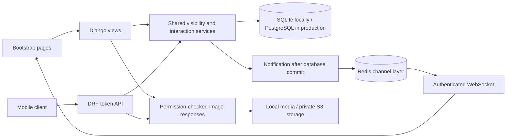

# Architecture and technical decisions

Gather is a Django monolith with server-rendered Bootstrap pages, a Django REST Framework API, and Django Channels for WebSocket notifications. It implements the required standard platform plus privacy, blocking, reporting, and staff moderation. Chat, groups, and events are optional extensions and are not implemented.

## Request paths

## Apps and entities

| App | Responsibilities |
| --- | --- |
| social_platform | Settings, ASGI/WSGI entry points, URL routing, test configuration |
| users | Built-in Django User plus one-to-one UserProfile; forms, profile, privacy, image validation, demo command |
| posts | Post, explicit Like join model, Comment, Report, feed queries, moderation admin |
| friends | Directed Follow, FriendRequest with pending/accepted/declined state, directed Block |
| notifications | Durable notifications, after-commit publication, per-user WebSocket groups |
| api | Serializers, authenticated routes, paginated resources |
| tests | Cross-layer behavior, permissions, uploads, WebSocket tests |

The built-in User model supplies password hashing, authentication, groups, and admin permissions. A post-save signal creates a profile for every new user. A pre-save signal revokes mobile tokens when an existing password changes.

A Like has a database unique constraint on (post, user). Follows, blocks, and directed requests also have unique constraints and reject self-connections. Reports must reference exactly one post or comment. Cascade deletion prevents orphan interactions. Reports retain reviewer identity and review time; Django admin also records staff actions.

Friendship is represented by an accepted request in either direction. Requests lock both user rows in a stable order under a transaction on PostgreSQL to serialize opposite-direction submissions. SQLite remains suitable for a local demonstration, not production concurrency. Duplicate pending requests return the existing record; opposite pending requests must be accepted by their recipient.

## Visibility algorithm

All website and API reads use shared query functions rather than trusting an ID or a client-provided author:

1. Require authentication; remove hidden posts and inactive authors.
2. Exclude users blocked in either direction.
3. Allow the author to read their own non-hidden posts.
4. Allow public posts from non-private profiles.
5. Allow public/friends posts from accepted friends, including private profiles.
6. Never expose Only me posts to anyone else, including friends.

Following only selects a feed; it grants no private access. Profile names, bios, locations, websites, avatars, covers, and connection counts are visible to signed-in non-blocked members. Email and password hashes are never serialized publicly. Hiding a post also hides its comments and post-linked notifications. Notifications are filtered again when delivered and listed, so a later privacy change is respected.

Uploaded images are served only through authenticated, permission-checked endpoints, including token authentication. There is no unrestricted /media/ route. Private S3 objects are read through the server; raw bucket URLs are not exposed in feeds. Existing form images are clearable without displaying raw storage URLs. Copies already downloaded cannot be recalled.

## Feed and performance

Feeds use deterministic newest-first ordering with primary-key tie breaking, page size 10 (web) or 20 (API). Selected authors/profiles and prefetched visible comments avoid per-post author/comment lookups. Aggregated counts and an EXISTS subquery mark liked posts. Database indexes cover creation times, foreign keys, unread notifications, and unique relationships. Search uses case-insensitive substring queries on post text and people; photo, friends, following, and author filters are supported.

Redis provides cross-process event distribution and shared rate-limit caching when configured. Local development uses an in-memory channel layer and cache. Notifications persist before publication; transport failure is logged without rolling back an otherwise successful interaction. The inbox is the durable source of truth. The browser reconnects with exponential backoff, but messages missed offline are not replayed as toasts.

No load benchmark or thousands-of-users capacity claim is made. Scaling would require query profiling, limiting long comment threads, PostgreSQL full-text indexes, cursor pagination, background image processing, media streaming/offload, and load testing. The current page prefetch includes all visible comments for each post, so very large threads need that follow-up work.

## Security and operations

Django provides CSRF checks, autoescaped templates, password validators, ORM parameterization, secure cookie options, host validation, and clickjacking protection. Sessions authenticate the website; opaque DRF tokens authenticate mobile clients. Password changes and the token logout endpoint revoke tokens. Tokens have no automatic expiration; use TLS and revoke on device loss. WebSocket connections use session authentication and allowed-origin validation, and clients cannot choose another user's group.

JPEG, PNG, and WebP uploads are validated by decoded format, filename, size (5 MB), and dimensions (20 MP). Filenames are randomized. SVG/HTML uploads and mismatched extensions are rejected. Ingress infrastructure should additionally enforce request-body and connection limits; application validation is not an ingress firewall.

Web login/signup have a per-address fixed-window limit. API login is limited to 10/minute, anonymous API use to 60/hour, and signed-in API use to 600/hour. Proxy deployments must apply a trusted edge rate limit too: the web limiter deliberately uses REMOTE_ADDR rather than trusting arbitrary forwarded IP headers. Private-profile policies are not cached, avoiding stale cross-user content.

Production startup requires a strong secret, a database URL, Redis, and private S3 storage. HTTPS redirect, secure cookies, HSTS, MIME sniffing protection, and manifest static files are enabled. Logs go to stdout. /health/ checks the database and configured Redis cache without revealing diagnostics. Runtime errors should be sent to a monitoring service before a public launch.
