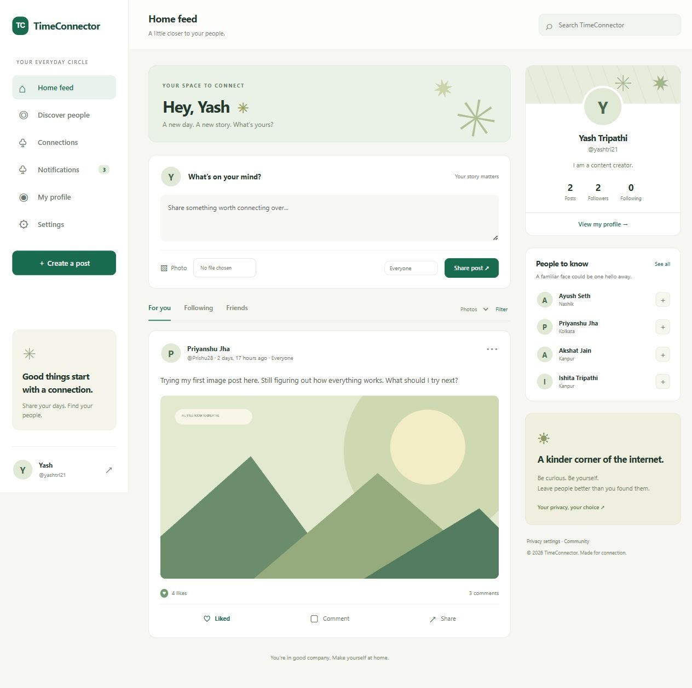
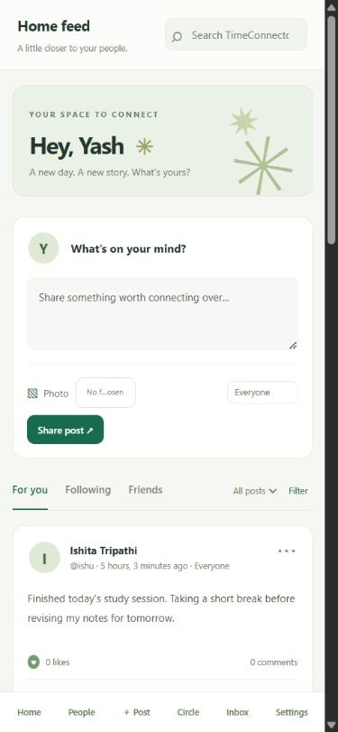
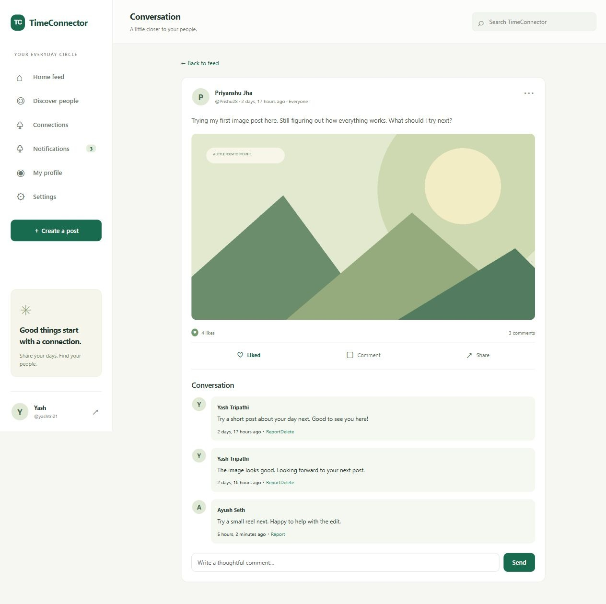
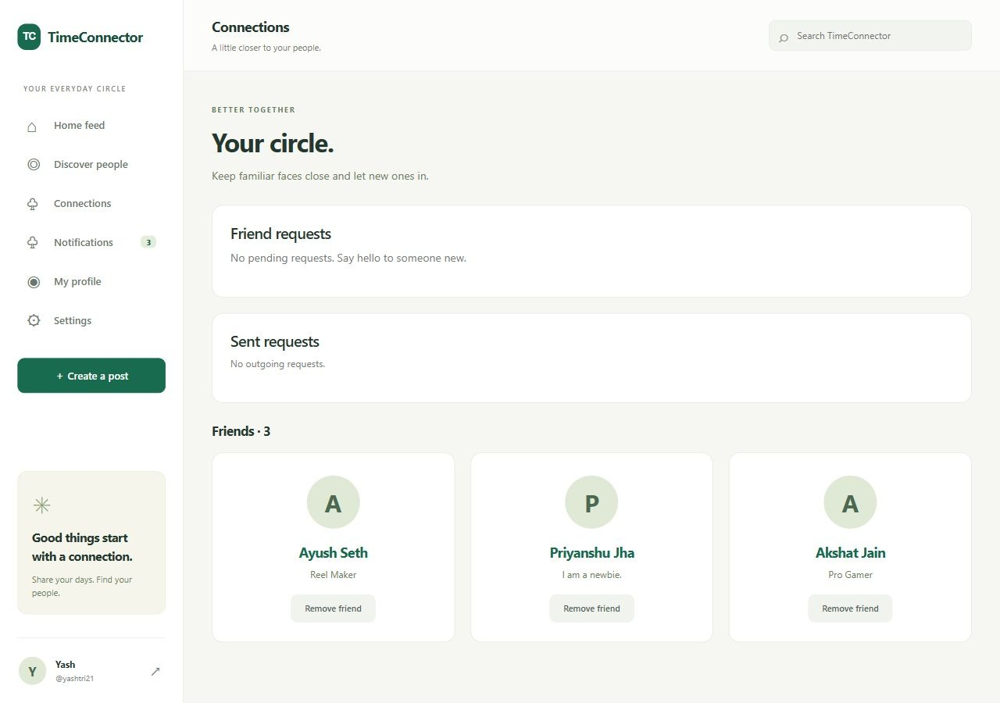
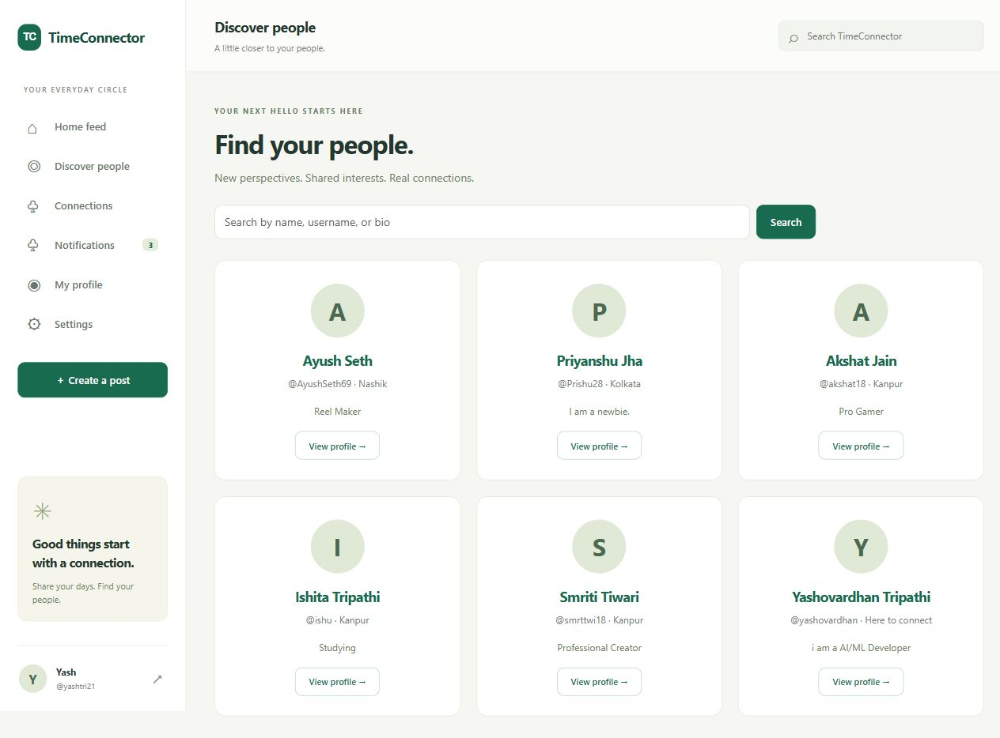

# Testing and validation

## Verified result

The latest local verification on 24 October 2026 used Python 3.13.9 and the installed locked dependencies, including Django 5.2.18. The existing verification helper completed all five checks successfully; the suite passed 56 tests in 7.573 seconds. Actual output is saved in [validation.txt](validation.txt). The screenshots were refreshed on 24 October after applying the six user-approved profiles. Original functional interaction observations are retained separately below.

| Check | Result |
| --- | --- |
| Django system check | Passed, no issues |
| Migration drift (makemigrations --check --dry-run) | Passed, no changes |
| Static asset collection | Passed, including manifest/compression |
| Automated test suite | 56 tests passed |
| Production settings check (--deploy) | Passed with placeholder infrastructure configuration |
| Python source compilation | Passed |
| Desktop browser | Login, post creation, likes, comment, photo feed, connections |
| Mobile browser | 390 × 844 viewport; feed/composer/navigation reviewed; no horizontal overflow |

The production settings check does not connect to PostgreSQL/Redis/S3. It validates configuration and Django's deployment checks only.

## Test coverage

The suite uses isolated in-memory SQLite storage, an in-memory image backend, a local cache and channel layer. Test-only password hashing is deliberately fast; normal app settings use Django's secure default hashers.

Critical cases include:

- Automatic profile creation; web registration/login; weak-password rejection.
- Token issue/revoke and invalidation after password change.
- Anonymous rejection, session CSRF rejection, safe escaped post content.
- Public/friends/Only me and private-profile visibility.
- Following does not grant private access; removing friendship revokes access.
- Bilateral blocks hide content and clear social relationships.
- Self-connection rejection; duplicate/opposite friend requests; recipient-only decisions.
- Post CRUD, empty-post validation, author spoof rejection, owner-only editing/deletion.
- Idempotent likes, comments, comment deletion ownership, hidden/blocked comment filtering.
- Profile updates; no email/hash exposure; default post audience.
- Search/following filters and invalid author input.
- Reports require exactly one accessible target; hidden content disappears.
- Recipient-only notifications, read state, self-notification suppression and privacy rechecks.
- Valid image upload; token-authenticated image read; private image denial.
- Rejection of disguised/oversized images and unsafe/mismatched filename extensions.
- Protected existing-file form widgets and image removal.
- Database like uniqueness, mutation methods and health response.
- Anonymous WebSocket rejection, foreign-origin rejection and authenticated saved-event delivery.

Tests deliberately produce 400/401/403/404 responses for denied actions. Those log lines are expected assertions, not failures.

## Repeat the checks

From the project root:

```powershell
.\.venv\Scripts\python.exe scripts\verify.py
```

This runs system checks, migration drift, static collection, 56 tests, and a production configuration check. It saves real output to docs/validation.txt and exits nonzero if any check fails. It forces development infrastructure settings for local verification and uses placeholders for the isolated production settings check; it never deploys or modifies cloud resources.

Individual commands appear in the README. CI configuration mirrors the core checks on Python 3.13, but a GitHub Actions run has not yet occurred.

## Browser evidence

On 24 October 2026, signed in as yashtri21, checked the desktop photo feed, discussion, connections and people directory, then reviewed the 390 × 844 mobile feed. The document width was 375 pixels within a 390-pixel viewport, with no horizontal overflow. Five screenshots were saved. No new likes, friendship decisions, or comments were submitted during this review.

### Earlier functional interaction checks (21 October)

The local ASGI server was opened in the in-app browser using local demo accounts. Actions verified through the rendered interface:

1. Signed in as yashtri21 and reached the populated feed.
2. Created a post with “Only me” selected and confirmed that audience on its detail page.
3. Filtered to photos and liked a post; count increased and button changed to Liked.
4. Submitted a comment and saw the saved comment and incremented count.
5. Viewed incoming requests and existing friends on Connections.
6. Reviewed the 390 × 844 mobile layout and navigation; document width did not exceed the viewport.

The separate automated tests verify that another account cannot read the private post or its image. Notification delivery was verified through ASGI WebSocket communicators; a two-browser production notification demonstration has not been run.

### Desktop feed



### Mobile feed



### Conversation



### Connections



Screenshots are actual browser captures, not mockups. The landscape is a procedurally drawn demo image. Profiles use user-supplied details and sample counts; the UI computes counts from database records.

### People directory



## Limits and remaining verification

- Cloud deployment is pending at the user's request.
- Docker/Compose have not run because Docker is not installed here.
- Real PostgreSQL, Redis and private S3 connectivity have not been tested.
- Concurrency/row-lock behavior has not been exercised against PostgreSQL.
- No load benchmark, penetration test, automated accessibility audit or multi-browser compatibility matrix was run.
- Optional chat/groups/events, email verification, self-service password reset and expiring mobile tokens are not implemented.
- WebSocket events missed offline remain available in the inbox but do not replay as live toasts.
- Current feeds prefetch all visible comments for a page of posts; bound large threads before claiming high-volume performance.

During implementation, checks exposed and corrected stable-pagination warnings, a missing Bootstrap source map reference, and a blank DATABASE_URL local fallback. The final validation log records the passing state.

## Profile personalization regression checks

Six tests in `tests/test_demo_personalization.py` cover approved seeding, repeatability without duplicate accounts/posts/comments, preserving IDs/passwords/tokens/relationships and administrator records, username-collision refusal, staff-account protection, production refusal, and refusing to seed duplicate original accounts. The total suite now contains 56 tests.

[Database preservation evidence](personalization-validation.txt) compares the actual local database with its pre-change backup, including the administrator profile and comments. All preservation checks passed. The administrator was not used for the browser sign-in.
