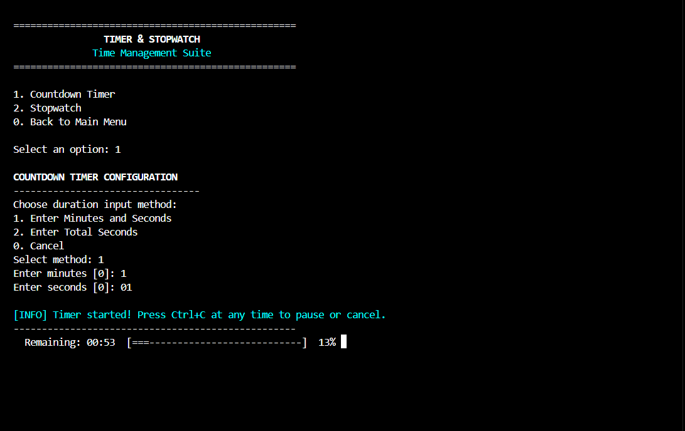
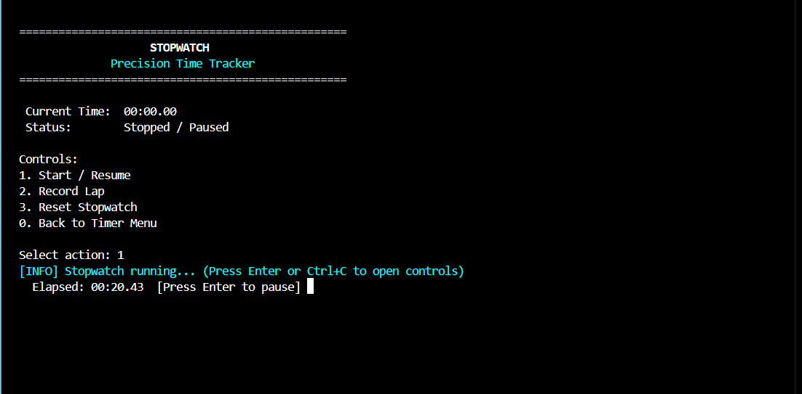
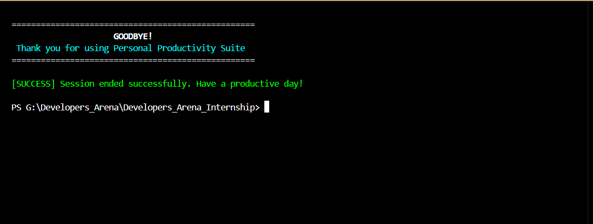

# Application Screenshots

This directory contains **nine existing PNG files** for the Personal Productivity Suite. Links use current filenames, including spaces, capitalization, and spelling. No screenshots were generated, renamed, or replaced during this README update.

## Inventory

| File | Application view |
| --- | --- |
| [main menu.png](main%20menu.png) | Main menu |
| [Calculator Tool.png](Calculator%20Tool.png) | Calculator |
| [Notes Manager.png](Notes%20Manager.png) | Notes manager |
| [CountDownManager.png](CountDownManager.png) | Countdown timer |
| [StopWatch.png](StopWatch.png) | Stopwatch |
| [File Organizer.png](File%20Organizer.png) | File organizer |
| [Meserment Convertor.png](Meserment%20Convertor.png) | Unit converter |
| [Backup manager.png](Backup%20manager.png) | Backup manager |
| [Exit.png](Exit.png) | Exit |

The inventory records available assets. It does not establish that every workflow, restore operation, or error path passed a current runtime test.

## Gallery

### Main menu

### Calculator

### Notes manager

### Countdown

### Stopwatch

### File organizer

### Unit converter

### Backup manager

### Exit

## Additional submission evidence

From the application directory, run `python main.py` (`python3 main.py` where needed). Capture the terminal with inputs and results visible, omitting private note contents and personal file paths.

Useful additional captures include:

- Invalid menu input or division by zero, followed by a return to the menu. No dedicated error-handling image is currently listed.
- TXT/JSON/CSV export results and notes persistence after restarting.
- A restore using disposable notes and a known-good backup.
- Actual output of `python -m pytest -v`, with environment and result retained.

Use a disposable directory for the organizer and select dry-run option `2` before moving files. Use Ctrl+C to pause a running stopwatch; Enter is advertised but not checked by its running loop. Ctrl+C cancels countdown without resume.

Use actual-run captures as execution evidence. Adding or renaming assets is a separate task and was not performed here.

[Back to application README](../../README.md)
